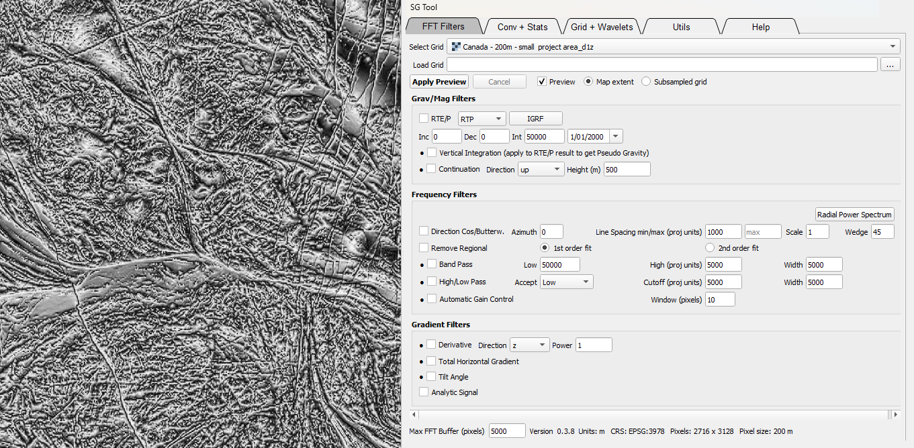

# Structural Geophysics Tool v0.3.9
 Simple Potential Field and other Geophysical Grid Calcs to assist WAXI/Agate Structural Geophysics Course    
 https://waxi4.org   and  https://agate-project.org    
    
 This plugin is available directly within **QGIS** using the Plugin Manager, however the latest **ArcGIS Pro** version or QGIS version with all new bugs will always be at this site.   

**<a href="https://tectonique.net/sgtools_data/SGTool%20Cheat%20Sheet.pdf">Cheat Sheet (Thanks Chops)</a>**&nbsp;**&nbsp;|&nbsp;&nbsp;&nbsp; <a href="https://tectonique.net/sgtools_data/Structural%20Geophysics%20Tools.pdf">Download Basic Help Document</a>**&nbsp;&nbsp;&nbsp; |&nbsp;&nbsp;&nbsp;  **<a href="https://tectonique.net/sgtools_data/SGTools_large.mp4">Ctrl-click on link to watch demo video</a>**
    
       

# Installation

- **QGIS**: install **Structural Geophysics Tool** from the QGIS Plugin Manager, or install the zip from the green **<> Code** button of this page. If QGIS warns that a Python package such as scikit-learn is missing, install the **qpip** plugin and let it add it.
- **ArcGIS Pro**: download this repository, clone the Pro Python environment, add a few packages and add the toolbox `ARCGIS/SGTool.pyt`.

Full steps for both, including the packages and which tools need them, are in [docs/installation.md](docs/installation.md).

# Documentation

SGTool works in both **QGIS** and **ArcGIS Pro**: the calculations are shared, and the two interfaces differ in a few places.

- [Installation](docs/installation.md)
- [ArcGIS Pro: differences from the QGIS version](docs/arcgis-pro.md), including the preview window and the toolbox
- [Live Preview](docs/live-preview.md) (QGIS), [Background Calculations](docs/background-calculations.md) (QGIS) and [Processing Algorithms](docs/processing-algorithms.md) (QGIS)
- [Provenance metadata and replaying a processing history](docs/provenance-and-replay.md): every output records how it was made, and the steps can be repeated on another grid
- [FFT filters](docs/filters-fft.md): reduction to the pole and equator, continuation, vertical integration, band / high / low pass, line-noise removal, derivatives, tilt angle, analytic signal
- [Convolution filters, spatial statistics, gridding and utilities](docs/filters-convolution-and-statistics.md): convolution and windowed statistics, anisotropy and MRVBF, PCA / ICA, Euler deconvolution, B-spline gridding (with automatic cell size and levels from the point spacing), worms, and utilities including clipping a grid to the map window and clipping every layer of a project to a polygon
- [Changelog](docs/changelog.md) (also in `metadata.txt`)

# Inputs   
- QGIS version supports data geotiff, grd, ers and Noddy (grv & mag) grid formats plus any grid format already supported by QGIS. ArcGIS Pro version supports grd plus any raster format supported by ArcGIS Pro.
- Supports csv, dat, xyz plus any point format already supported by QGIS
- Existing Noddy mag and grav files can be found at the Atlas of Structural Geophysics: https://tectonique.net/asg/
- New Noddy models can be calculated using the Windows version at https://tectonique.net/noddy/OpenNoddy_installer.exe or a python wrapper at https://github.com/cgre-aachen/pynoddy
   

# How To   
1) Load a raster image from file
- If a GRD grid (Oasis Montaj) is selected, the plugin will attempt to load CRS from the associated xml file, if this is not possible a CRS of EPSG:4326 is assumed. In any case the grid is saved as geotiff.
2) Whatever layer is shown in the layer selector will be the one processed by whatever combination of filters are selected by check boxes. Scratch/temporary grids (e.g. "memory" outputs from other processing tools) can be processed directly, since QGIS/ArcGIS still backs them with a readable file even though they aren't permanently saved.
- All processed files will be saved as geotiffs, and will be saved in the same directory as the original file, and will have a suffix added describing the processing step.
- If a RTP or RTE calculation is performed, it is possible to define the magnetic field manually or the IGRF mag field parameters can be assigned based on the centroid of grid, plus survey date, or embedded geotiff metadata if the source of the tif was a Noddy grid file..
- If a file exists on disk it will be overwritten, although QGIS plugins don't always like saving to disks other than C: on Windows, and can't overwrite a file if the grid is open in another program.
- Length units are defined by grid properties except for Up/Down Continuation (so Lat/Long wavelengths should be defined in degrees!)
3) If multiple processing steps are required, first apply one process, select the result and then apply subsequent steps.

# Alternatives   
There are several excellent Open Source or at least free alternatives to this plugin if you don't want to use QGIS, or want to do things this plugin can't:   
- Fatiando Harmonica https://www.fatiando.org/harmonica/
- GravMagSuite https://github.com/fcastro25/GravMagSuite
- GSSH https://cires1.colorado.edu/people/jones.craig/GSSH/index.html
- UBC Toolkit https://toolkit.geosci.xyz/content/Demos/SyntheticFilters.html
- gravmag https://github.com/birocoles/gravmag
- Fourpot https://sites.google.com/view/markkussoftware/gravity-and-magnetic-software/fourpot
- GridMerge https://www.gridmerge.com.au/home
- GammaSpec https://www.gammaspec.com.au/ 

# Code development
- You can explore the codebase and functionality at the <a href="https://deepwiki.com/swaxi/SGTool">DeepWiki Code description</a>   
- Calcs ChatGPT, Claude and Mark Jessell
- Plugin construction - Mark Jessell using QGIS Plugin Builder Plugin https://g-sherman.github.io/Qgis-Plugin-Builder/    
- IGRF calculation -  using pyIGRF https://github.com/ciaranbe/pyIGRF
- GRD Loader & Radially averaged power spectrum Fatiando a Terra crew & Mark Jessell https://www.fatiando.org/
- Example geophysics data in image above courtesy of Mauritania Govt. and USGS https://anarpam.mr/en/     
- Worming of grids uses Frank Horowitz's bsdwormer  https://bitbucket.org/fghorow/bsdwormer/
- Wavelet Transform base code - https://github.com/PyWavelets/pywt 
- Multilevel BSpline Gridding and MRVBF converted to python from SAGA code -https://saga-gis.sourceforge.io/
- Euler Deconvolution uses Felipe F. Melo and Valéria C.F. Barbosa's Reliable Euler method https://github.com/ffigura/Euler-deconvolution-python   
- Variable RTP modified from code kindly supplied by Gordon Cooper, Uni Witwatersrand, see Cooper & Cowan, Computers & Geosciences 31 (2005) 989–999   https://doi.org/10.1016/j.cageo.2005.02.005

