[← Back to the documentation](README.md)

# SGTool reference

This reference describes every tab, control and filter of SGTool: its settings and defaults, its output, the equation and published method behind it, how SGTool's code relates to that method, and an example of the filter applied to real data. For step-by-step instructions see the [user guide](user-guide.md). Installation is described in [Installation](installation.md).

The reference is written for the **QGIS** plugin. The ArcGIS Pro version shares the calculations and most of the interface; where it differs is described in [ArcGIS Pro](#arcgis-pro).

For each method, *Reference* gives the primary published source (listed in full under [References](#references)) and *In SGTool* says what SGTool's code does with it: whether the code is original, translated or adapted from someone else's, and where it differs from the published method.

**Contents**

- [Example data and figures](#example-data-and-figures)
- [Controls common to all tabs](#controls-common-to-all-tabs)
- [Running calculations](#running-calculations): [Live preview](#live-preview), [Background calculations](#background-calculations)
- [Output names](#output-names)
- [FFT Filters tab](#fft-filters-tab): [How the FFT filters are applied](#how-the-fft-filters-are-applied), [Grav/Mag](#gravmag-filters), [Frequency](#frequency-filters), [Gradient](#gradient-filters)
- [Conv + Stats tab](#conv--stats-tab): [Convolution](#convolution-filters), [Spatial statistics](#spatial-statistics), [Multivariate](#multivariate-statistical-analysis), [Euler](#euler-deconvolution)
- [Grid + Wavelets tab](#grid--wavelets-tab): [Import](#import-point-or-line-data), [Gridding](#gridding), [Worms](#bsdworms)
- [Petrophys tab](#petrophys-tab)
- [Utils tab](#utils-tab): [Provenance metadata](#sgtool-metadata-provenance), [Replaying a history](#apply-the-same-steps-to-another-grid), [Threshold to NaN](#threshold-to-nan), [Clipping](#clip-to-window), [Normalise](#normalise-grids), [LUT to grey scale](#convert-lut-to-grayscale)
- [Help tab](#help-tab)
- [QGIS Processing algorithms](#qgis-processing-algorithms)
- [ArcGIS Pro](#arcgis-pro)
- [References](#references)

---

## Example data and figures

The examples use `ogrm_usgs_mag_tmi.tif`, an aeromagnetic total magnetic intensity grid of part of Mauritania (courtesy of the Mauritanian Government (OMRG) and the USGS), linked from the plugin's Help tab: 924 x 629 cells of 175 m, WGS 84 / UTM zone 29N, -1410 to 5005 nT. See [The example data](user-guide.md#1-the-example-data) in the user guide.

- Each figure shows the input on the left and the result on the right, with the settings in the title. The results were calculated with SGTool's own filter code (`sgt_filters.py`, also used by the dialog and the Processing algorithms).
- Magnetic reductions use the IGRF field for the dialog's default date, 1 January 2000, at the grid centre: inclination 29.2°, declination -5.4°, total field 36,751 nT.
- Unless stated otherwise, filters are applied to the RTP grid, `ogrm_usgs_mag_tmi_RTP`, and window statistics to its first vertical derivative.
- Figures marked *zoomed* show the 38 x 56 km area outlined below, where the effect of filters that act over a few cells can be seen.
- Grids such as TMI and RTP are drawn with a histogram-equalised colour scale. Derivatives and other zero-centred results use a blue-white-red scale centred on zero.

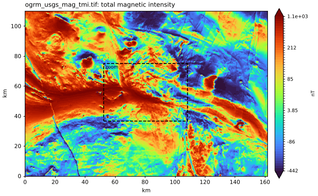

### Supported inputs

- **Grids**: in QGIS, GeoTIFF, Geosoft `.grd`, ER Mapper `.ers` and Noddy (`.grv`, `.mag`) grids, plus any grid format QGIS reads. In ArcGIS Pro, `.grd` plus any raster format ArcGIS Pro reads. Scratch or temporary grids (for example "memory" outputs of other processing tools) can be processed directly, as QGIS and ArcGIS Pro still back them with a readable file.
- **Points**: CSV, ASEG-GDF2 `.dat` and `.xyz`, plus any point format QGIS reads.
- **Noddy models**: existing Noddy magnetic and gravity grids are in the [Atlas of Structural Geophysics](https://tectonique.net/asg/). New models can be calculated with the [Windows version of Noddy](https://tectonique.net/noddy/OpenNoddy_installer.exe) or the Python wrapper [pynoddy](https://github.com/cgre-aachen/pynoddy).

---

## Controls common to all tabs

| Control | Where | What it does |
|---|---|---|
| **Select Grid** | Top of FFT Filters, Conv + Stats, Petrophys and Utils | The grid the tab's filters are applied to. Each tab has its own. Lists the raster layers in the project. |
| **Load Grid** and **...** | FFT Filters | Loads a grid from a file: GeoTIFF, Geosoft `.grd`, ER Mapper `.ers`, Noddy `.grv` and `.mag`. A `.grd` takes its CRS from its `.xml` file, or EPSG:4326 if there is none, and is saved as a GeoTIFF. Other formats can be loaded with QGIS's own raster loader. |
| **Apply Processing** | Top of each tab | Applies each ticked filter to the selected grid, as a [background calculation](#background-calculations). Each filter gives its own output; the filters are unticked afterwards. While **Preview** is ticked the button reads **Apply Preview** and saves the previewed filter at full resolution. |
| **Apply to Window** | Beside Apply | While previewing: clips the grid to the map window (as [Clip to Window](#clip-to-window)), selects the clip and applies the previewed filter to it. |
| **Cancel** | Beside Apply | Stops a running calculation. Nothing is saved. |
| **Preview** | Beside Cancel | Shows one filter on the area in the map window in a temporary layer, updated as settings change. See [Live preview](#live-preview). |
| **Max FFT Buffer (pixels)** | Bottom of FFT Filters | Upper limit of the padding added on each side of the grid before an FFT filter. Default 5000. The padding is the grid's smaller dimension, up to this value. |
| **Version / Units / CRS / Pixels / Pixel size** | Bottom of each tab | The plugin version and, for the selected grid, its length units (m or deg), CRS, size in cells and cell size. |
| **●** | Before some filters | Filters marked with a dot should be applied to magnetic data reduced to the pole or equator (or to gravity data). |

**Lengths** are in the grid's units (metres for a projected grid, degrees for a latitude/longitude grid), except for continuation heights, which are always in metres. Lat/long grids whose CRS QGIS does not flag as geographic (for example ER Mapper `.ers`) are treated as geographic.

**Files on disk.** An existing file with the output's name is overwritten, unless the name is taken by a layer in the project, in which case the new output gets `_1`, `_2` and so on. On Windows, QGIS plugins sometimes fail to save to drives other than C:, and no program can overwrite a grid that is open in another program.

---

## Running calculations

### Live preview

(In ArcGIS Pro the preview is in its own window: see [ArcGIS Pro](#arcgis-pro).)

The **FFT Filters**, **Conv + Stats**, **Petrophys** and **Utils** (Threshold to NaN) tabs have a fixed bar at the top with **Apply Processing** (which reads **Apply Preview** while previewing) on the left and the preview controls to its right, so they stay visible while you scroll the filter list.

- **Preview**: tick it to see the selected filter without writing any files. A single temporary layer called `<grid><suffix>_preview` is added to the project and is replaced in place each time a parameter changes, so layers do not accumulate. Updates wait a fraction of a second after the last edit, so typing a value does not trigger a calculation for every digit.
- **One filter at a time**: while previewing, ticking a second filter unticks the first, and editing a filter's parameters selects that filter. Filters that cannot be previewed (Differential RTP, local anisotropy, MRVBF, PCA, ICA, Euler deconvolution, and the clipping polygon) are disabled until Preview is switched off.
- **What is calculated**: the area currently shown in the map canvas, so panning or zooming updates the preview. It is at full resolution once at most 1000 cells (on the longest side) are in view; a larger view, such as a big grid zoomed out, is block-averaged to 1000 cells. In a block-averaged preview, filters set in pixels (convolutions, window statistics, AGC) act on the coarser cells, and line noise cannot be seen if the preview cell size exceeds the line spacing: zoom in for those.
- **Edge effects**: filters show edge effects along the edges of the view, and a zoomed-in view only contains wavelengths that fit in it. Zoom out to preview long-wavelength filters (upward continuation, regional removal, low pass, reduction to the pole on broad anomalies).
- **Apply Preview**: while Preview is ticked the **Apply Processing** button is renamed **Apply Preview** and stays available. Pressing it calculates the previewed filter at full resolution, adds it as a normal permanent layer (with the usual name and suffix), switches preview off and unticks the filters.
- **Apply to Window**: the button beside **Apply Preview**, available while Preview is ticked with a filter that can be previewed. It first clips the grid being previewed to the area shown in the map window, exactly as **Utils > Clip to Window** does (saved beside it as `<name>_clip.tif` and loaded), selects the clip as the tab's grid, and then applies the previewed filter to the clip at full resolution, as **Apply Preview** does.
- **Unticking Preview** (or closing the plugin) discards the temporary layer. Unticking the last ticked filter clears the image but keeps preview mode on, so ticking a filter brings it straight back. **Changing tab** unticks the filters of the tab you leave and removes the image, and Preview is ticked on the next tab that has one (Grid + Wavelets has none, so Preview waits and returns afterwards); turning Preview off yourself ends it for good.
- **Calculated in the background**: QGIS stays usable while a preview is calculated, and the image appears when it is ready. **Cancel** stops it (useful after zooming out over a big grid), panning, zooming or editing a setting replaces a preview still being calculated, and starting another job replaces it and redraws it afterwards.
- The preview layer is shown with bilinear resampling, both zoomed in (to reduce the blocky look of a coarse preview) and zoomed out.

### Background calculations

(In ArcGIS Pro the GUI runs calculations in a background thread and has a **Cancel** button that ends a job at once; see [ArcGIS Pro](#arcgis-pro).)

Calculations run as QGIS background tasks, so QGIS stays usable while they work, progress shows in the task manager and status bar, and a calculation can be cancelled (the red X in the task manager or the Cancel button ends the task at once; a calculation that is part-way through a single FFT step finishes in the background, its result is thrown away and nothing is saved). This covers everything started by **Apply Processing** (all the filters, statistics, MRVBF, PCA/ICA, boundary outline and Euler deconvolution, including several ticked together), the live preview itself, saving it with **Apply Preview**, B-spline gridding, worms, grid normalisation, RGB to grey-scale and Geosoft `.grd` conversion.

- **Cancel**: each tab has a **Cancel** button (on the Grid + Wavelets tab it is "Cancel running calculation"), and QGIS's own task manager has one too. The buttons are only enabled while a calculation is running, and **Apply Processing** is disabled so a second one cannot be started on top (except during a preview, when **Apply Preview** stays available and replaces it).
- **How quickly it stops**: cancelling is cooperative. It takes effect between the steps of a job and inside long loops (Euler deconvolution, median filter, window statistics, worms levels and polylines, B-spline levels, normalising a folder of grids), so a very long single filter finishes its current step first. A cancelled job saves nothing, and the filters you ticked stay ticked so you can run it again.
- **Safe to keep working**: the settings are snapshotted when you press Apply, so editing the dialog, changing the selected grid or using the preview while a calculation runs does not affect it.
- **Messages** raised during a calculation (for example "geographic grids need projected coordinates") are shown when it finishes, and a failure is reported in the message bar with the details in the Python console.
- Importing XYZ/CSV/DAT points and the GRASS IDW dialog still run in the foreground.

---

## Output names

Each result is saved as a GeoTIFF beside the input grid, named after it with a suffix, and added to the project. Apart from the derivative's power and direction, the settings are not in the name; they are recorded in the file's [provenance metadata](#sgtool-metadata-provenance). A name already in use gets `_1`, `_2` and so on.

| Filter | Suffix | Filter | Suffix |
|---|---|---|---|
| Reduction to the pole | `_RTP` | Mean | `_Mn` |
| Low-latitude RTP | `_RTP_LL` | Median | `_Md` |
| Differential RTP | `_DRTP` (+ `_DRTP_inc`, `_DRTP_dec`) | Gaussian | `_Gs` |
| Reduction to the equator | `_RTE` | Directional | `_Dr` |
| Vertical integration | `_VI` | Sun shading | `_Sh` |
| Upward / downward continuation | `_UC` / `_DC` | Min / Max | `_SS_Min` / `_SS_Max` |
| Line-noise removal | `_DirC` (noise estimate: `_DirC_noise`) | Variance / Std deviation | `_SS_Var` / `_SS_StdDev` |
| Remove regional | `_RR` | Skewness / Kurtosis | `_SS_Skew` / `_SS_Kurt` |
| Band pass | `_BP` | Local anisotropy | `_SS_AnisoMag`, `_SS_AnisoOrient` |
| High pass / low pass | `_HP` / `_LP` | MRVBF | `_MRVBF`, `_MRRTF`, `_slope` + composite |
| Automatic gain control | `_AGC` | PCA / ICA | `_PCA` / `_ICA` |
| Derivative | `_d<power><direction>`, e.g. `_d1z`, `_d0.5x` | Euler deconvolution | `_estimates_SI_<n>.txt` |
| Tilt angle | `_TA` | Threshold to NaN | `_Clean` |
| Analytic signal | `_AS` | Clipping polygon | `_boundary` (shapefile) |
| Total horizontal gradient | `_THG` | Clip to window | `_clip` |
| Apparent susceptibility | `_AppSus` | Worms | `_worms.csv` (+ `_worms.shp`) |
| Apparent density | `_AppDens` | LUT to grey scale | `_gray` |

---

## FFT Filters tab

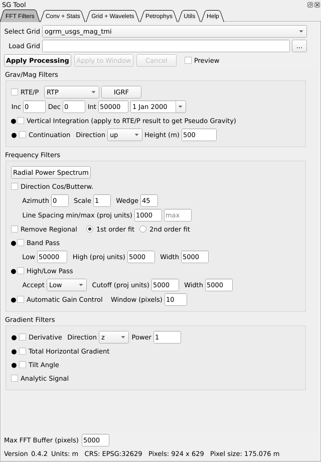

### How the FFT filters are applied

All the filters on this tab work in the Fourier domain, except Remove Regional and AGC.

*In SGTool* (original code): every FFT filter subtracts the grid's median, fills no-data cells with the value of the nearest valid cell, pads the grid to a size whose only factors are 2, 3 and 5 with a linear ramp to zero, tapers the padded grid towards its edges with a Tukey (cosine) window, multiplies the spectrum by the filter, transforms back, removes the padding, restores the no-data cells and adds the median back (except for derivatives, the line-noise estimate and apparent petrophysics, which are zero-mean). The padding on each side is the grid's smaller dimension, up to the **Max FFT Buffer** setting. RTE and the low-latitude RTP pad by mirroring the edges instead (see below).

In the equations, $`k = \sqrt{k_x^2 + k_y^2}`$ is the wavenumber in radians per grid unit, $`k_x`$ and $`k_y`$ its components in the x and y directions, and $`\theta`$ the azimuth of the wavenumber, clockwise from north, $`\theta = \arctan(k_x / k_y)`$.

### Grav/Mag Filters

#### RTE/P (reduction to the pole or equator)

Tick **RTE/P** and choose the method in the list.

| Setting | Default | Meaning |
|---|---|---|
| Method list | RTP | **RTP**, **Low-lat. RTP**, **Diff. RTP** or **RTE** (below) |
| **IGRF** | | Fills in Inc, Dec and Int from the IGRF model at the centre of the selected grid on the date shown. If the grid came from Noddy, the values are read from its GeoTIFF metadata. |
| **Inc** | 0 | Magnetic inclination, degrees from horizontal (positive down) |
| **Dec** | 0 | Magnetic declination, degrees clockwise from north |
| **Int** | 50000 | Total field strength, nT |
| Date | 1 Jan 2000 | Survey date, 1900 to 2030, used by **IGRF** and by Diff. RTP |
| **Iterations** (Low-lat. RTP only) | blank (auto) | Number of iterations of the equator-to-pole operator; blank chooses it automatically |
| **Stripe suppression (°)** (Low-lat. RTP only) | 10 | The iterations fade out within this angle of the direction perpendicular to the declination; 0 turns it off |

| Method | When to use | Output |
|---|---|---|
| **RTP** | Inclination steeper than about 20° | `_RTP` |
| **Low-lat. RTP** | Inclination shallower than about 20° | `_RTP_LL` |
| **Diff. RTP** | Large surveys where the field direction varies. Inc and Dec come from the IGRF, so the Inc and Dec boxes are not used. Cannot be previewed. | `_DRTP`, `_DRTP_inc`, `_DRTP_dec` |
| **RTE** | Low inclinations, as an alternative to low-latitude RTP | `_RTE` |

Input: a TMI anomaly grid (IGRF removed). RTP and RTE warn when Inc and Dec are both 0.

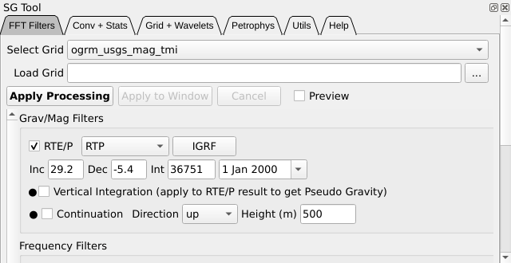

##### Reduction to the pole

$`H_{RTP}(\theta) = \frac{1}{[\sin I + i \cos I \cos(D-\theta)]^2} = \frac{k^2}{[k \sin I + i \cos I \,(k_x \sin D + k_y \cos D)]^2}`$

Converts magnetic data measured at any inclination and declination to what it would be if measured at the magnetic pole, assuming the magnetisation is induced (parallel to the field). I is the magnetic inclination, D the declination (both in radians) and i the imaginary unit.

*Reference*: Baranov (1957); Baranov & Naudy (1964); Fourier-domain form from Gunn (1975).
*In SGTool*: original code. Filter values larger than 10<sup>6</sup> are set to 0; there is no other low-latitude stabilisation, so close to the magnetic equator use the Low-latitude RTP or RTE. (The equation shown in the documentation before 2026 was not the one the code uses.)

**Example: RTP** (Inc 29.2, Dec -5.4). Dipolar anomalies become single anomalies over their sources. At this moderate inclination, RTP also amplifies features that run along the declination, giving the north-south streaks in the south.

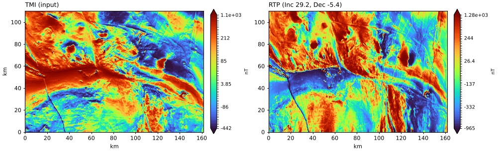

##### Low-latitude reduction to the pole (Taylor series iterative)

Stable RTP for low magnetic latitudes. The data are first reduced to the equator

$`C(\theta) = \frac{-\cos^2(D-\theta)}{[i \cos I \cos(D-\theta) + \sin I]^2}`$

and then to the pole with m iterations of a truncated (two-term Taylor series) equator-to-pole operator $`H_{ea} = -[1 + (D-\theta)^2/2]^2`$, which in closed form is

$`\tilde T_p = \{1 - [1 - C_{pe} H_{ea}]^{m+1}\} H_e \tilde T_e`$, with $`H_e = -\sec^2(D-\theta)`$ and $`C_{pe} = -\cos^2(D-\theta)`$.

More iterations get closer to the exact (unstable) RTP; the gain perpendicular to the declination is limited to about 5(m+1). The number of iterations is chosen automatically (0 to 200) as the one whose result correlates best with the analytic signal amplitude of the input grid. Assumes induced magnetisation only.

- **Iterations**: blank (0) chooses them automatically; fewer give less striping along the declination but a less complete reduction.
- **Stripe suppression (°)**: close to the equator the data hold almost no signal in the directions perpendicular to the declination, so what the operator amplifies there is mostly noise, edge effects and levelling errors, which show as stripes parallel to the declination. Within about this angle $`\sigma`$ of that direction the iterations fade out, $`m_{eff} = m\,[1 - e^{-(\phi/\sigma)^2}]`$, $`\phi`$ being the angle of the wavenumber from the perpendicular. 0 turns it off (the method as published); 10° (the default) helps at any low inclination, 20° suits data within a few degrees of the equator, and wider values start to blur real features at higher inclinations. When the iterations are chosen automatically, they are chosen before the suppression is applied.
- The grid is padded by mirroring its edges, tapered to zero within the padding: padding that extends each column straight out from the north and south edges (as the other FFT filters do) makes streaks along the declination, which this operator turns into stripes across the grid.

*Reference*: Hao et al. (2018).
*In SGTool*: original code (2026) implementing the paper's Eqs. 4, 5, 13 and 14. The closed form (Eq. 13) is used rather than iterating, evaluated so that it stays finite perpendicular to the declination. The automatic choice tries a fixed set of 21 values of m from 0 to 200 rather than every value. The stripe suppression and the mirror padding are SGTool additions, not part of the published method.

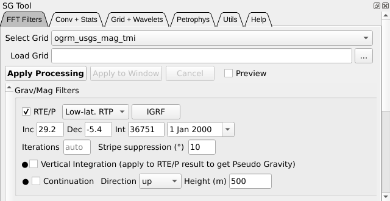

**Example: low-latitude RTP** (Inc 29.2, Dec -5.4, automatic iterations, stripe suppression 10°). Fewer streaks along the declination than the RTP.

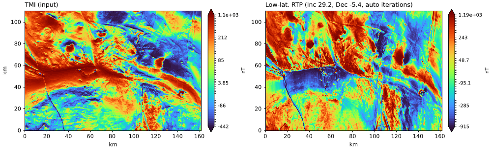

##### Variable (differential) reduction to the pole

Accounts for the spatial variation of inclination and declination across a survey area by applying a Taylor-series expansion of the standard RTP operator. The IGRF field is computed at the four grid corners and the centre for the date shown, then bilinearly interpolated to build spatially varying inclination and declination grids. The expansion is evaluated at 13 perturbed inc/dec pairs and combined to give a single corrected output. Outputs: `_DRTP` (corrected field), and `_DRTP_inc` and `_DRTP_dec` (the interpolated inclination and declination fields used; saved but not loaded). Recommended for surveys covering several degrees of latitude or longitude, where a single inc/dec value would introduce systematic phase or amplitude errors.

*Reference*: Cooper & Cowan (2005).
*In SGTool*: a line-by-line Python translation (Mark Jessell, 2026) of Gordon Cooper's MATLAB `rtpvariable.m`, supplied by its author. SGTool adds the IGRF calculation of the corner and centre values and the filling and restoring of no-data cells.

**Example: differential RTP**, compared with the ordinary RTP. The example grid spans only about 1.6° of longitude and 1° of latitude (inclination 28.2° to 30.3° at the corners), so the two are almost the same.

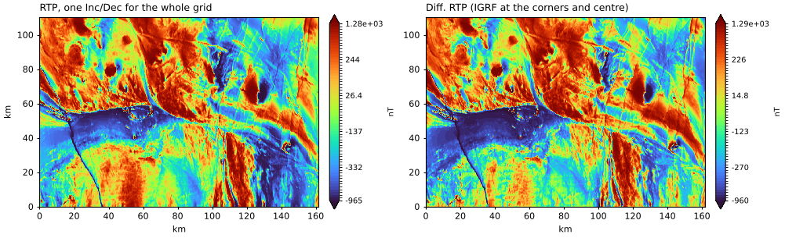

##### Reduction to the equator

$`H_{RTE}(\theta) = \frac{-\cos^2(D-\theta)}{[\sin I + i \cos I \cos(D-\theta)]^2}`$

Converts magnetic data measured at any inclination and declination to what it would be if measured at the magnetic equator (same declination); at I = 0 it leaves the data unchanged.

*Reference*: Kis (1990); also Eq. 5 of Hao et al. (2018).
*In SGTool*: original code, evaluated as $`-\cos^2(D-\theta)\,\bar f^2/|f|^4`$ with $`f = \sin I + i\cos I\cos(D-\theta)`$, so the denominator is real. Corrected in 2026: the earlier code did not square the denominator, so at I = 0 it multiplied the data by $`\cos^2(D-\theta)`$ instead of leaving them unchanged, and at other inclinations it gave anomalies that were too weak. The grid is padded by mirroring its edges, because the operator changes sharply near the direction perpendicular to the declination and would otherwise smear the streaks that ramp padding makes along the declination into the grid.

**Example: RTE** (Inc 29.2, Dec -5.4). At the equator, an induced anomaly is a low over its source, elongated perpendicular to the declination.

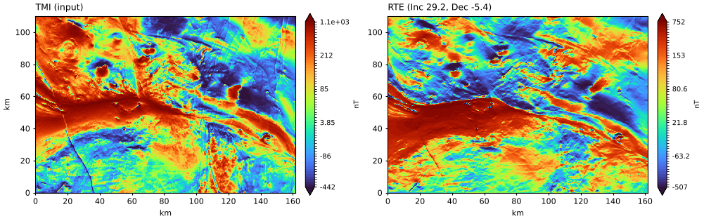

#### Vertical Integration ●

$`H(k_x, k_y) = \frac{1}{k}`$

Integrates the field vertically. Applied to an RTP or RTE grid it gives a result proportional to the **pseudogravity**: the gravity anomaly the sources would produce if their density were proportional to their magnetisation, which has the same decay with distance from the source as gravity and so can be compared with it. Also useful for stitched grids with very different line spacings. No settings. Needs a metre-based projection. Output `_VI`.

*Reference*: pseudogravity, Baranov (1957); the integration operator, Gunn (1975).
*In SGTool*: original code. k is not allowed below 10<sup>-4</sup> rad/m, so the longest wavelengths stay finite. The constants of Poisson's relation (G and the ratio of magnetisation to density) are not applied, so the result is proportional to the pseudogravity, not equal to it.

**Example** (of the RTP). Anomalies broaden and the long wavelengths dominate.

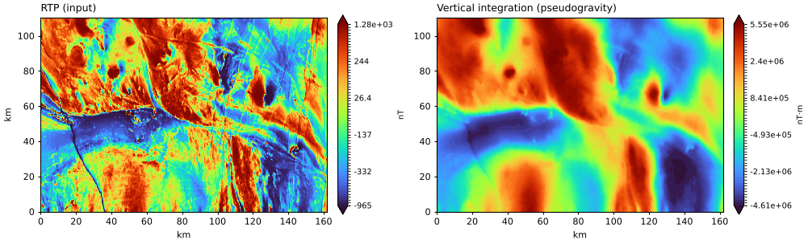

#### Continuation ●

$`H(k) = e^{-k h}`$ (upward), $`H(k) = e^{k h}`$ (downward), where h > 0 is the continuation distance.

| Setting | Default | Meaning |
|---|---|---|
| **Direction** | up | **up**: the field at a greater height; **down**: at a smaller height |
| **Height (m)** | 500 | Distance to continue, always in metres |

Upward continuation (UC) smooths the field as if measured higher up, attenuating noise and shallow sources. Downward continuation (DC) sharpens it, enhancing shallow, short-wavelength anomalies. Output `_UC` or `_DC`.

*Reference*: Henderson & Zietz (1949); Fourier-domain form from Bhattacharyya (1965) and Gunn (1975).
*In SGTool*: original code. Downward continuation is not stabilised, so it amplifies short-wavelength noise very quickly; keep h small compared with the depth to the sources. For a geographic grid the height is converted roughly to degrees.

**Example: upward continuation, 2000 m.**

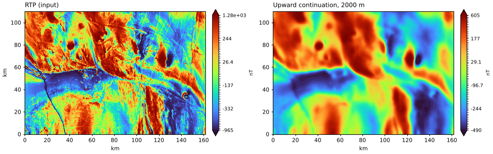

**Example: downward continuation, 100 m** (zoomed). Even 100 m (less than one cell) sharpens the anomalies noticeably and starts to amplify noise.

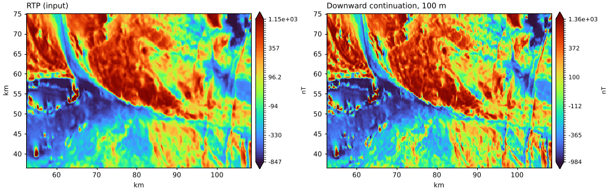

### Frequency Filters

#### What the cutoff values mean

The values entered for the High pass, Low pass and Band pass filters are **wavelengths**, in the length units of the grid (metres, or degrees for a geographic grid), not frequencies. A wavelength is the distance over which a feature repeats, so it is the inverse of frequency: *short* wavelength = *high* frequency (small, sharp, usually shallow features) and *long* wavelength = *low* frequency (broad, smooth features). The equations below use the wavenumber $k = 2\pi/\lambda$.

- **High pass** keeps wavelengths *shorter* than the cutoff and removes longer ones (regionals, deeper sources).
- **Low pass** keeps wavelengths *longer* than the cutoff and removes shorter ones (noise, shallow sources).
- **Band pass** keeps the wavelengths between two values. **Low** is the *longest* wavelength kept (longer wavelengths, i.e. lower frequencies, are cut) and **High** is the *shortest* wavelength kept (shorter wavelengths, i.e. higher frequencies, are cut), so the Low value is the larger number (for example 50000 and 5000).
- **Width** (transition width, same units) is how gradually the filter switches from pass to reject: 0 is a sharp cut, and larger values reduce ringing.

*Relationship to source depth (approximate).* The signal from a source at depth $z$ falls off with wavelength $\lambda$ as $e^{-2\pi z/\lambda}$, the same factor that governs upward continuation, so a deep source cannot produce short wavelengths. A source at depth $z$ typically has its main response at wavelengths of about 3 to 6 times $z$. As a rough guide, a cutoff of 6000 m separates sources shallower than about 1000 to 2000 m (kept by a high pass) from deeper ones (kept by a low pass), and a band pass between $\lambda_{high}$ and $\lambda_{low}$ favours sources from about $\lambda_{high}/6$ to $\lambda_{low}/3$. This is only a guide: a shallow, broad source also has long wavelengths, and potential-field data are inherently ambiguous, so filtering by wavelength is not a true depth slice.

#### Radial Power Spectrum

$`P(k) = \frac{1}{N_k} \sum_{(k_x, k_y) \in k} |\text{FFT}(f)|^2`$

where P(k) is the radially averaged power spectrum and N<sub>k</sub> the number of samples in the radial bin.

The **Radial Power Spectrum** button opens a window with the selected grid and its spectrum: ln(power) against wavenumber, in radians per cell (a wavenumber *k* is a wavelength of 2π/*k* cells). Straight segments of the curve correspond roughly to groups of sources at similar depths, and the breaks between them suggest cutoffs for the frequency filters. Needs matplotlib. (Marked as needing more testing.)

*Reference*: Spector & Grant (1970), for using the radially averaged spectrum to estimate source depths.
*In SGTool*: original code. No-data cells are set to 0 before the transform, ln P is plotted against wavenumber, and no depths are estimated.

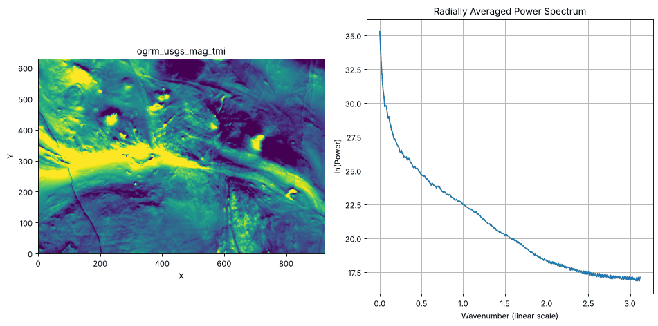

#### Direction Cos/Butterw. (line-noise removal)

Removes noise parallel to the flight lines. A zero-mean noise estimate *N* is made by passing the grid through a Butterworth band pass and a directional wedge, and is subtracted after scaling: $`T' = T - s\,N`$.

$`H(k, \theta) = \frac{1}{1 + (k_h/k)^{2n}} \cdot \frac{1}{1 + (k/k_l)^{2n}} \cdot W(\theta)`$

$`W(\theta) = \cos^2\!\left(\frac{\pi\,\Delta}{2w}\right)`$ for $`\Delta \le w`$, 0 beyond

where

- $k_h = 2\pi/(10 \times \text{largest line spacing})$ and $k_l = 2\pi/(2 \times \text{smallest line spacing})$: the band kept, so that the regional, which also varies across the lines, is not taken as noise.
- n = 4 : Butterworth order.
- $\Delta$ : angle between the wavenumber and the azimuth, measured modulo 180°, so that both lobes of the spectrum are treated.
- w : wedge half-width.
- s : scale.

| Setting | Default | Meaning |
|---|---|---|
| **Azimuth** | 0 | Direction of the flight lines (and so of the stripes), degrees clockwise from north |
| **Scale** | 1 | s, the multiplier applied to the noise estimate before subtracting it. Values of 2 or more over-subtract. |
| **Wedge** | 45 | w, the half-width of the wedge of directions, degrees. Wider keeps more of the noise, and more of the geology that runs parallel to the lines. |
| **Line Spacing min** | 1000 | Smallest line spacing, in grid units |
| **Line Spacing max** | blank | Largest line spacing; leave blank if the spacing is constant (the min value is used) |

Output `_DirC`. The QGIS Processing algorithm *Remove line noise* can output the noise estimate *N* instead (`_DirC_noise`).

*Reference*: Butterworth (1930) for the filter response; removing line noise with a directional filter follows the micro-levelling idea of Minty (1991).
*In SGTool*: original code. The band limits (2 to 10 times the line spacing), the cos² wedge and the scale are SGTool's choices, and unlike Minty (1991) the noise estimate is not amplitude-limited before it is subtracted. (The Butterworth high-pass and |cos|<sup>p</sup> directional filter described in the documentation before 2026 are not the filters the dialog uses.)

**Example** (zoomed). The example grid has little line noise, so synthetic north-south line noise (a random level error on lines 700 m apart, plus a slow drift along each line) was added to the TMI. Both grids are shown as their first vertical derivative, where stripes are easiest to see. Settings: Azimuth 0, Line Spacing 700, Scale 1, Wedge 10.

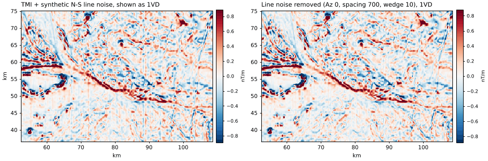

The noise estimate for the same settings (Output: Noise estimate). It should look like stripes along the lines, not like geology.

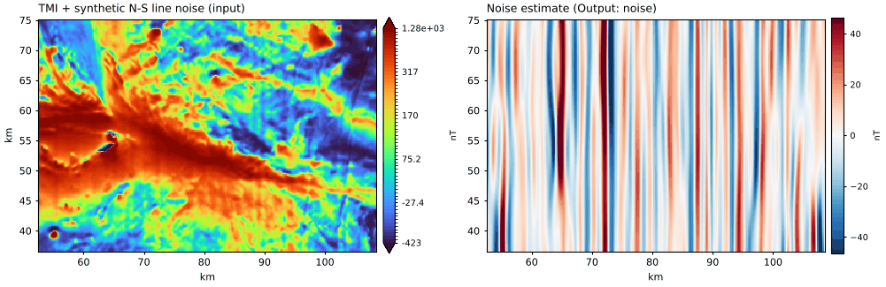

#### Remove Regional

Removes a 1st order (dipping plane) or 2nd order (parabolic surface) regional from the data.

| Setting | Default | Meaning |
|---|---|---|
| **1st order fit** / **2nd order fit** | 1st order | Subtract a least-squares plane (1st order) or quadratic surface (2nd order) |

Output `_RR`.

*Reference*: least-squares trend-surface fitting, a standard method with no single primary reference.
*In SGTool*: original code: the plane or quadratic surface is fitted by least squares to the valid cells and subtracted.

**Example: 1st order** (of the TMI).

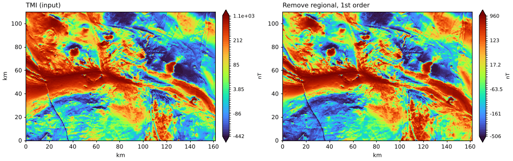

#### Band Pass ●

```math
H(k) = H_{high}(k) \times H_{low}(k)
```

with the high-pass component

```math
H_{high}(k) = \begin{cases}
0 & \text{if } k \leq k_{h,low} \\
\frac{1}{2}\left(1 - \cos\left(\pi \frac{k - k_{h,low}}{k_{h,high} - k_{h,low}}\right)\right) & \text{if } k_{h,low} < k < k_{h,high} \\
1 & \text{if } k \geq k_{h,high}
\end{cases}
```

and the low-pass component

```math
H_{low}(k) = \begin{cases}
1 & \text{if } k \leq k_{l,inner} \\
\frac{1}{2}\left(1 + \cos\left(\pi \frac{k - k_{l,inner}}{k_{l,outer} - k_{l,inner}}\right)\right) & \text{if } k_{l,inner} < k < k_{l,outer} \\
0 & \text{if } k \geq k_{l,outer}
\end{cases}
```

where

- $k_{h,low} = \frac{2\pi}{\lambda_{low} + w_h/2}$ and $k_{h,high} = \frac{2\pi}{\lambda_{low} - w_h/2}$ : high-pass transition boundaries
- $k_{l,inner} = \frac{2\pi}{\lambda_{high} + w_l/2}$ and $k_{l,outer} = \frac{2\pi}{\lambda_{high} - w_l/2}$ : low-pass transition boundaries
- $\lambda_{low}$ : the **Low** cutoff wavelength (removes longer wavelengths); $\lambda_{high}$ : the **High** cutoff wavelength (removes shorter wavelengths)
- $w_h$, $w_l$ : the transition widths (both set by **Width**)

The band-pass filter isolates features within a range of wavelengths by combining high-pass and low-pass components with smooth transitions.

| Setting | Default | Meaning |
|---|---|---|
| **Low** | 50000 | The *longest* wavelength kept, in grid units |
| **High (proj units)** | 5000 | The *shortest* wavelength kept, in grid units |
| **Width** | 5000 | Width of the cosine transition at each cutoff; 0 is a sharp cut |

Output `_BP`. *Reference* and *In SGTool*: see [High/Low Pass](#highlow-pass-).

**Example: Low 20000, High 2000, Width 1000.**

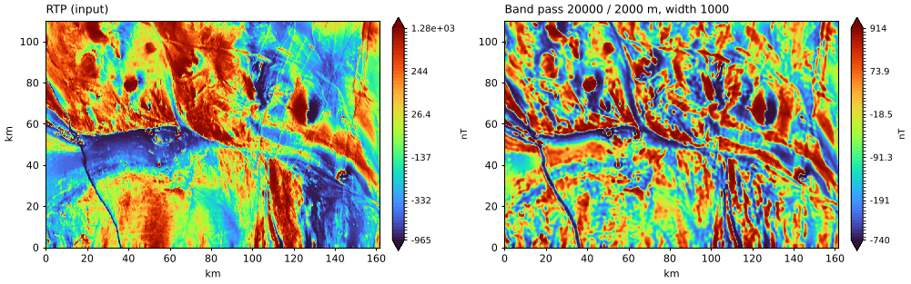

#### High/Low Pass ●

**High pass**: removes long wavelengths and keeps short ones, with a smooth transition to reduce ringing.

```math
H(k) = \begin{cases}
0 & \text{if } k \leq k_{low} \\
\frac{1}{2}\left(1 - \cos\left(\pi \frac{k - k_{low}}{k_{high} - k_{low}}\right)\right) & \text{if } k_{low} < k < k_{high} \\
1 & \text{if } k \geq k_{high}
\end{cases}
```

with $k_{low} = \frac{2\pi}{\lambda_c + w/2}$ and $k_{high} = \frac{2\pi}{\lambda_c - w/2}$, $\lambda_c$ the cutoff wavelength and $w$ the transition width.

**Low pass**: removes short wavelengths and keeps long ones.

```math
H(k) = \begin{cases}
1 & \text{if } k \leq k_{inner} \\
\frac{1}{2}\left(1 + \cos\left(\pi \frac{k - k_{inner}}{k_{outer} - k_{inner}}\right)\right) & \text{if } k_{inner} < k < k_{outer} \\
0 & \text{if } k \geq k_{outer}
\end{cases}
```

with $k_{inner} = \frac{2\pi}{\lambda_c + w/2}$ and $k_{outer} = \frac{2\pi}{\lambda_c - w/2}$.

| Setting | Default | Meaning |
|---|---|---|
| **Accept** | Low | **High**: keep wavelengths shorter than the cutoff; **Low**: keep wavelengths longer than the cutoff |
| **Cutoff (proj units)** | 5000 | $\lambda_c$, the cutoff wavelength, in grid units |
| **Width** | 5000 | $w$, the width of the cosine transition; 0 is a sharp cut |

Output `_HP` or `_LP`.

*Reference* (high, low and band pass): ideal filters with a raised-cosine (Hann) transition band, a standard design with no single primary reference.
*In SGTool*: original code. With a transition width of 0 the low pass is a sharp cut; when $\lambda_c - w/2 \le 0$ the outer edge of the transition is set to 1.5 times the cutoff wavenumber instead.

**Example: high pass, cutoff 10000, width 2000.** The residual: shallow sources.

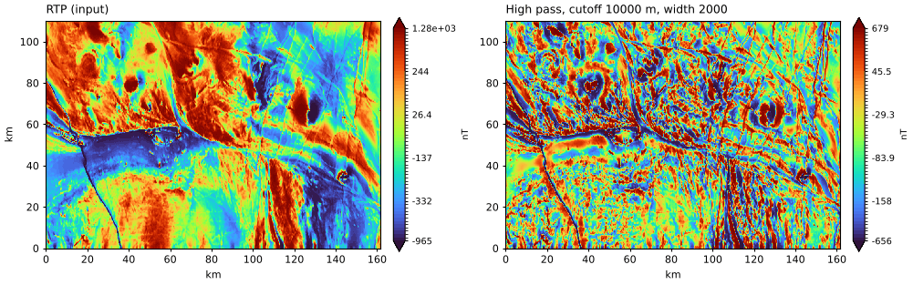

**Example: low pass, cutoff 10000, width 2000.** The regional: broad, deeper sources.

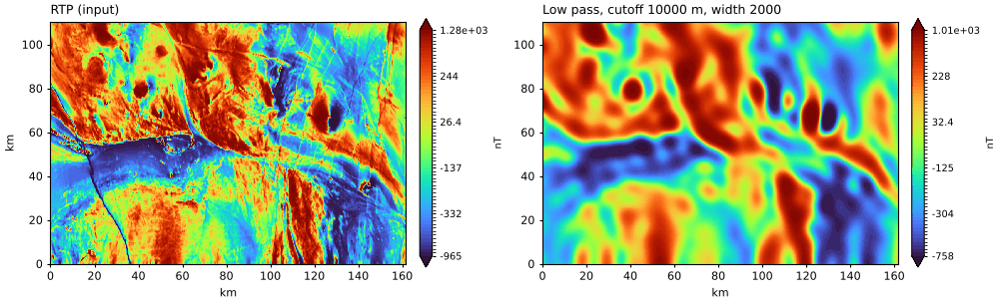

#### Automatic Gain Control ●

$`AGC(x, y) = \frac{f(x, y)}{G_w * |f|(x, y)}`$

where $`G_w * |f|`$ is the absolute value of the data smoothed with a Gaussian of standard deviation w (the window size, in cells).

| Setting | Default | Meaning |
|---|---|---|
| **Window (pixels)** | 10 | w, the standard deviation, in cells, of the Gaussian |

Divides the grid by its local amplitude, so weak and strong anomalies show equally. The result is a ratio with no physical units. Output `_AGC`.

*Reference*: Rajagopalan & Milligan (1994).
*In SGTool*: original code. The local amplitude is the Gaussian-smoothed absolute value, not a windowed RMS (the RMS form shown in the documentation before 2026 is not what the code does), the edges are reflected, and no other scaling is applied.

**Example: window 10.**

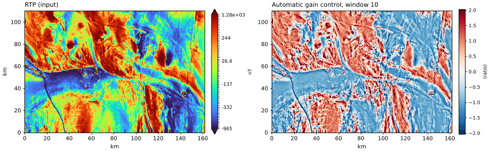

### Gradient Filters

#### Derivative ●

$`H_x = (i k_x)^n, \quad H_y = (i k_y)^n, \quad H_z = k^n`$

where n is the power of the derivative (it can be fractional). The vertical derivative is calculated from the horizontal gradients using Laplace's equation, $\frac{\partial^2 f}{\partial x^2} + \frac{\partial^2 f}{\partial y^2} + \frac{\partial^2 f}{\partial z^2} = 0$, which gravity and magnetic fields satisfy outside their sources. In the Fourier domain this multiplies the spectrum by $k$, so the vertical derivative amplifies short wavelengths, and often noise as well.

| Setting | Default | Meaning |
|---|---|---|
| **Direction** | z | **z** (vertical), **x** (east) or **y** (north) |
| **Power** | 1 | n, the order of the derivative; fractional values are allowed (e.g. 0.5) |

Output `_d<power><direction>`, for example `_d1z` (first vertical derivative, 1VD). The result is zero-mean.

*Reference*: Bhattacharyya (1965); Gunn (1975).
*In SGTool*: original code. (The rotated-gradient formula shown in the documentation before 2026 is not what the code does: the derivative is taken along x, y or z only.)

**Example: first vertical derivative (z, power 1).** Shallow sources and edges stand out; noise is amplified too.


**Example: x derivative, power 1.** Edges running north-south are enhanced.

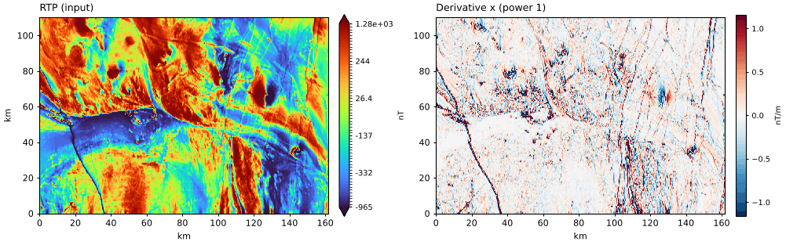

**Example: vertical derivative, power 0.5.** Between the RTP and the 1VD.

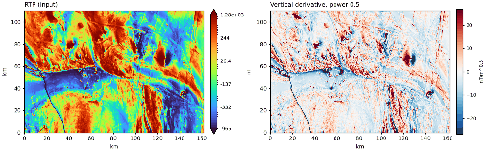

#### Total Horizontal Gradient ●

$`THG(x, y) = \sqrt{\left(\frac{\partial f}{\partial x}\right)^2 + \left(\frac{\partial f}{\partial y}\right)^2}`$

On RTP or gravity data its maxima lie over the edges of sources. No settings. Output `_THG`.

*Reference*: Cordell & Grauch (1985).
*In SGTool*: original code, with the horizontal derivatives calculated in the Fourier domain.

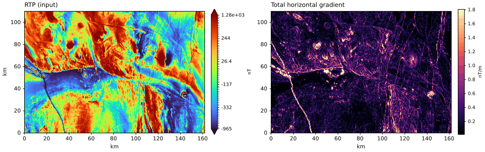

#### Tilt Angle ●

$`T = \tan^{-1}\left(\frac{\frac{\partial f}{\partial z}}{\sqrt{\left(\frac{\partial f}{\partial x}\right)^2 + \left(\frac{\partial f}{\partial y}\right)^2}}\right)`$

Enhances edges and shallow sources by balancing the vertical derivative against the horizontal ones, so strong and weak anomalies show equally; the 0° contour lies roughly over the edges of vertical sources. Tends to over-connect structural features. The result is saved in degrees (-90 to 90). No settings. Output `_TA`.

*Reference*: Miller & Singh (1994).
*In SGTool*: original code, with the derivatives calculated in the Fourier domain.

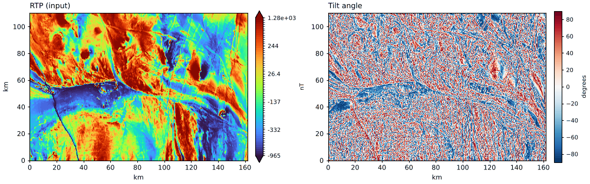

#### Analytic Signal

$`A(x, y) = \sqrt{\left(\frac{\partial f}{\partial x}\right)^2 + \left(\frac{\partial f}{\partial y}\right)^2 + \left(\frac{\partial f}{\partial z}\right)^2}`$

The total amplitude of the gradients, independent of field inclination and declination (exactly so only for 2D sources; approximately in 3D). Its maxima lie over the sources and their edges, so it can be used on TMI data at low latitudes. No settings. Output `_AS`.

*Reference*: Nabighian (1972) for 2D sources; Roest, Verhoef & Pilkington (1992) for the 3D amplitude.
*In SGTool*: original code, with the derivatives calculated in the Fourier domain.

**Example** (of the TMI).

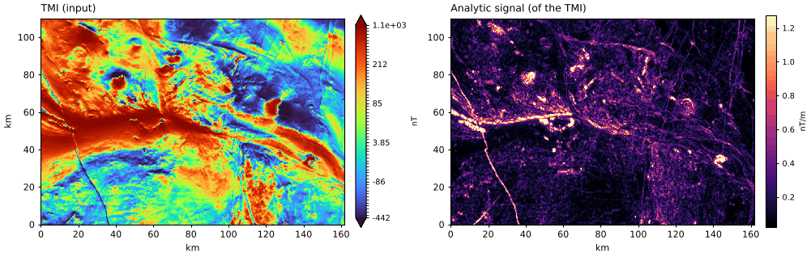

---

## Conv + Stats tab

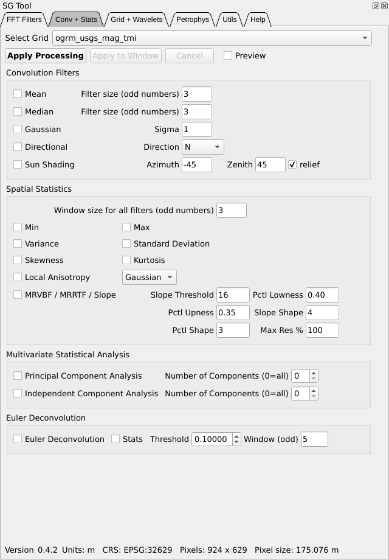

The tab has its own **Select Grid**. Filter sizes and windows are in cells.

### Convolution Filters

| Filter | Setting | Default | Output |
|---|---|---|---|
| **Mean** | Filter size (odd number of cells) | 3 | `_Mn` |
| **Median** | Filter size (odd number of cells) | 3 | `_Md` |
| **Gaussian** | Sigma (cells) | 1 | `_Gs` |
| **Directional** | Direction: N, NE, E, SE, S, SW, W, NW | N | `_Dr` |
| **Sun Shading** | Azimuth, Zenith (degrees), relief | -45, 45, ticked | `_Sh` |

#### Mean

Averages the values in an n x n window.

*Reference*: a standard moving-average filter, with no single primary reference.
*In SGTool*: original code. No-data cells are left out of each average (normalised convolution: the sum of the valid values divided by their number), and the edges are reflected.

**Example: mean, 9 x 9** (zoomed).

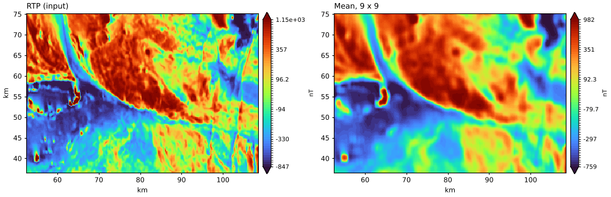

#### Median

The median of the values in an n x n window. Removes spikes and keeps edges.

*Reference*: Tukey (1977).
*In SGTool*: original code. No-data cells are left out of each median, and cells beyond the edges count as no data.

**Example: median, 9 x 9** (zoomed). Edges stay sharper than with the mean.

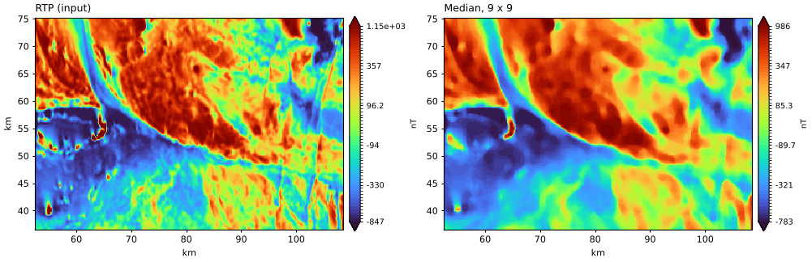

#### Gaussian

Smooths with a Gaussian of the given standard deviation (sigma, in cells).

*Reference*: a standard smoothing kernel, with no single primary reference.
*In SGTool*: original code. The kernel is cut off at about 2 standard deviations (2⌈2σ⌉+1 cells across), normalised to sum to 1, and applied as a normalised convolution that leaves no-data cells out.

**Example: Gaussian, sigma 3** (zoomed).

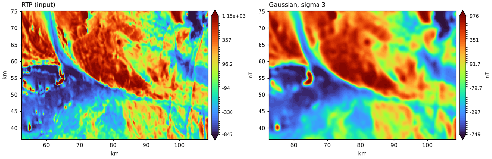

#### Directional

A compass-gradient filter that enhances edges facing the chosen direction (NE, N, NW, W, SW, S, SE, E).

*Reference*: the 3 x 3 compass gradient kernels of Prewitt (1970).
*In SGTool*: original code. For a kernel size n larger than 3, the 3 x 3 kernel is padded with zeros, so the result is the same as with n = 3.

**Example: directional, NE** (zoomed).

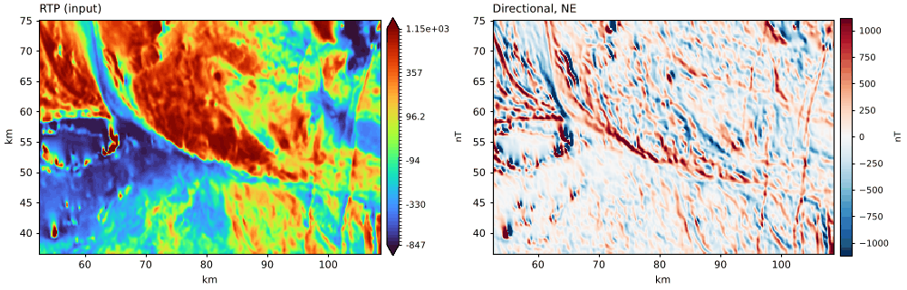

#### Sun Shading

Relief shading of a digital elevation model or any other grid, lit from the sun's **Azimuth** (degrees clockwise from north) at **Zenith** degrees above the horizon. Features perpendicular to the azimuth are enhanced most.

*Reference*: Horn (1981).
*In SGTool*: with **relief** ticked, a vectorised Python translation of the GRASS GIS `r.relief` module (GRASS Development Team), with 3 x 3 Sobel-type gradients; otherwise original code that shades the surface normal from central differences with a Lambertian light source. For a geographic grid the cell size is converted roughly to metres.

**Example: sun shading, azimuth 45, zenith 45, relief.**

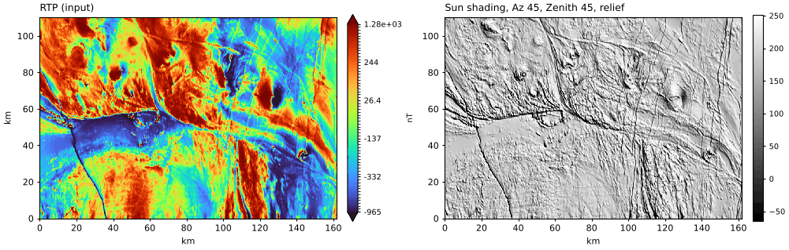

### Spatial Statistics

| Setting | Default | Meaning |
|---|---|---|
| **Window size for all filters** | 3 | Diameter of the circular window, in cells (odd) |
| Window type (beside Local Anisotropy) | Gaussian | Gaussian or box smoothing of the gradient products |

Tick any of the statistics below. Each is saved as its own grid. Standard deviation and variance are slow on large grids and windows, skewness and kurtosis very slow.

| Statistic | Output | What it shows |
|---|---|---|
| **Min**, **Max** | `_SS_Min`, `_SS_Max` | Smallest and largest value around the central cell |
| **Variance**, **Standard Deviation** | `_SS_Var`, `_SS_StdDev` | How much the values vary in the window: texture or roughness |
| **Skewness** | `_SS_Skew` | Asymmetry of the values in the window |
| **Kurtosis** | `_SS_Kurt` | How peaked the values are |
| **Local Anisotropy** | `_SS_AnisoMag`, `_SS_AnisoOrient` | How linear the grid is (0 to 1) and the strike of the linear features (0 to 180°) |

*Reference* (Min to Skewness): standard sample statistics, with no single primary reference.
*In SGTool* (Min to Skewness): original code. The window is a circle whose diameter is the window size, no-data cells are left out, and a window needs at least 3 valid values. Skewness and kurtosis follow `scipy.stats` (biased estimates; kurtosis is the excess kurtosis, 0 for a normal distribution; a near-constant window gives no-data), calculated for many windows at once.

The examples are of the RTP 1VD, with a window of 9 cells (15 for the anisotropy magnitude). The anisotropy orientation example is of the RTP tilt angle (`_TA`), with a window of 3.

**Standard deviation** (zoomed).

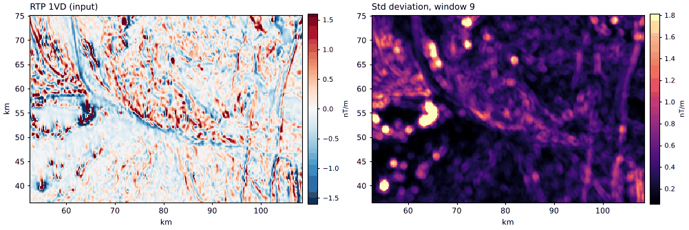

**Variance** (zoomed).

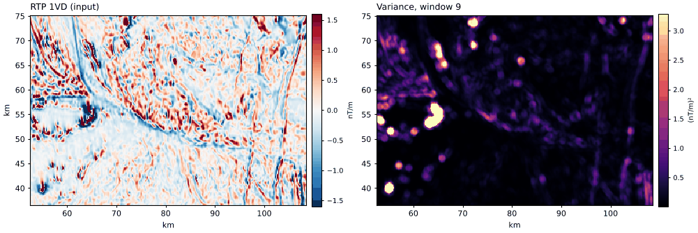

**Min** (zoomed).

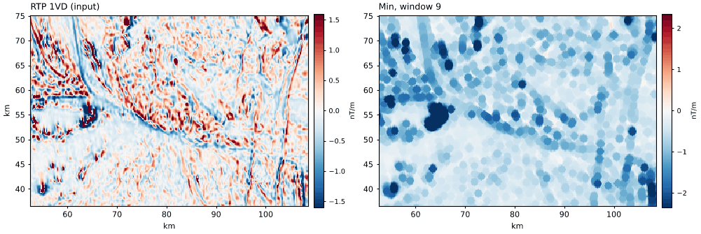

**Max** (zoomed).

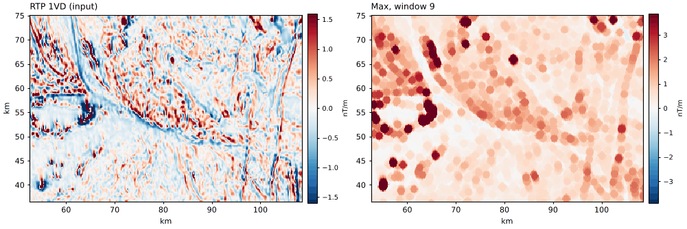

**Skewness** (zoomed).

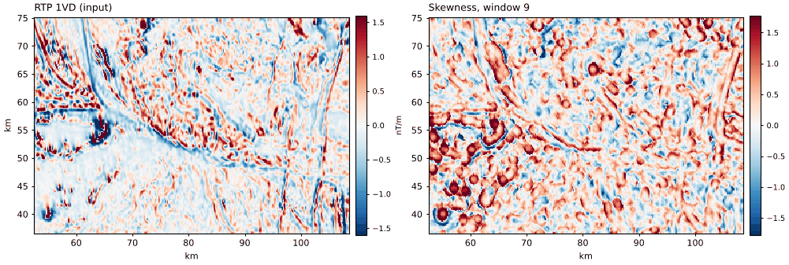

**Kurtosis** (zoomed).

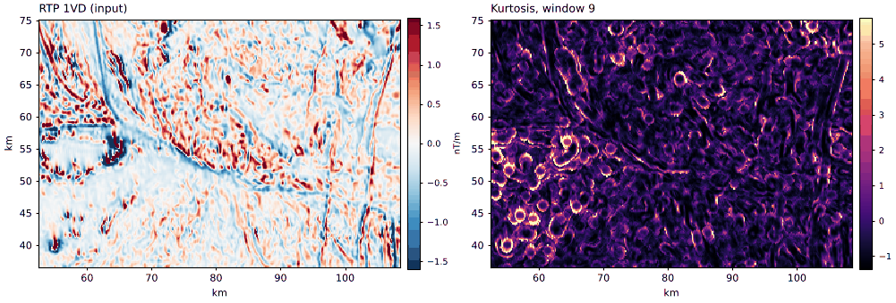

#### Local Anisotropy

Uses the structure tensor (second-moment matrix) of local Sobel gradients to quantify the strength and orientation of linear structure at each cell. The gradient products are smoothed over a window (Gaussian or box) of the window size.

Structure tensor elements:
$`J_{11} = \text{smooth}(I_x^2), \quad J_{12} = \text{smooth}(I_x I_y), \quad J_{22} = \text{smooth}(I_y^2)`$

Eigenvalues:
$`\lambda_1 = \tfrac{1}{2}\!\left(J_{11}+J_{22}+\sqrt{(J_{11}-J_{22})^2+4J_{12}^2}\right), \quad \lambda_2 = \tfrac{1}{2}\!\left(J_{11}+J_{22}-\sqrt{(J_{11}-J_{22})^2+4J_{12}^2}\right)`$

Anisotropy magnitude (saliency), normalised to [0, 1] by the 99th-percentile value:
$`\text{AnisoMag} = \text{clip}\!\left(\tfrac{\lambda_1 - \lambda_2}{p_{99}},\; 0,\; 1\right)`$

Dominant orientation:
$`\theta = \tfrac{1}{2}\arctan\!\left(\tfrac{2J_{12}}{J_{11}-J_{22}}\right) \bmod 180°`$

Returns two layers: `_SS_AnisoMag` (0–1 saliency; 0 = flat or isotropic, 1 = strong linear feature) and `_SS_AnisoOrient` (0–180° dominant strike). Cannot be previewed.

*Reference*: the structure tensor, Kass & Witkin (1987); Bigün, Granlund & Wiklund (1991).
*In SGTool*: original code. The gradients are Sobel derivatives, and the normalisation of the saliency by its 99th percentile is SGTool's choice.

**Example: local anisotropy magnitude**, window 15.

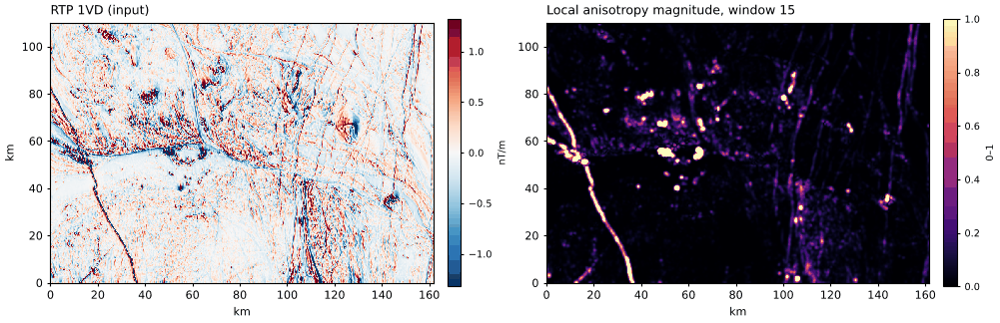

**Example: local anisotropy orientation of the RTP tilt angle**, window 3. The colour scale is cyclic, as 0° and 180° are the same strike.

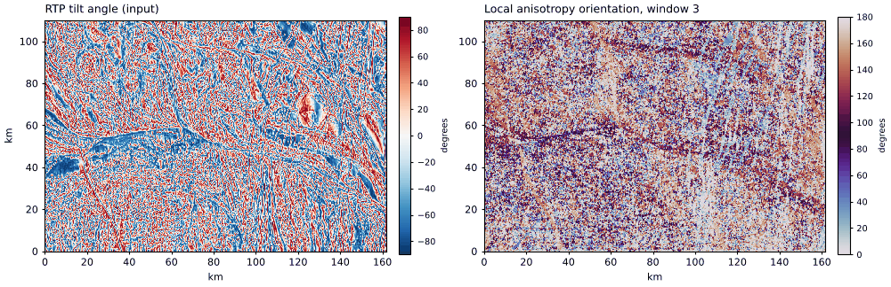

The same, zoomed. The strikes follow the individual linear features of the tilt angle.

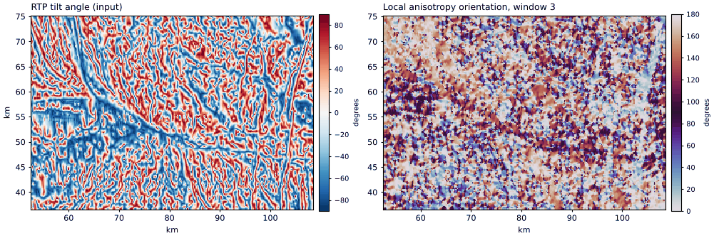

#### MRVBF / MRRTF / Slope

Classifies a digital terrain model by its hilltop and valley-bottom flatness and slope: multiresolution valley bottom flatness (MRVBF) and ridge top flatness (MRRTF), combined with slope as an RGB composite. Writes `_MRVBF`, `_MRRTF` and `_slope` grids and a three-band (MRRTF, MRVBF, slope) composite. Needs a DEM in a metre-based projection. Cannot be previewed.

| Setting | Default | Meaning |
|---|---|---|
| **Slope Threshold** | 16 | Initial slope threshold (percent) at the finest resolution |
| **Pctl Lowness** | 0.40 | Threshold for the lowness percentile (valley bottoms) |
| **Pctl Upness** | 0.35 | Threshold for the upness percentile (ridge tops) |
| **Slope Shape** | 4 | Shape parameter of the slope transformation |
| **Pctl Shape** | 3 | Shape parameter of the elevation percentile transformation |
| **Max Res %** | 100 | Coarsest resolution, as a percentage of the grid diagonal |

*Reference*: Gallant & Dowling (2003); slope from Zevenbergen & Thorne (1987).
*In SGTool*: a statement-by-statement Python translation of SAGA's MRVBF tool (O. Conrad, `ta_morphometry`), which agrees with SAGA to about 32-bit float precision. Combining MRRTF, MRVBF and slope into an RGB image is SGTool's addition. In ArcGIS Pro the slope is calculated in numpy (QGIS uses its own slope tool).

### Multivariate Statistical Analysis

| Filter | Setting | Default | Output |
|---|---|---|---|
| **Principal Component Analysis** | Number of Components (0 = all) | 0 | `_PCA` |
| **Independent Component Analysis** | Number of Components (0 = all) | 0 | `_ICA` |

Both work on the bands of a **multiband** grid (for example K, Th and U radiometrics stacked into one file); each component is one band of the output. Need scikit-learn. Cannot be previewed.

**Principal Component Analysis** transforms correlated variables into orthogonal components that maximise variance, creating a new coordinate system where the first component captures the most variance.
*Reference*: Pearson (1901); Hotelling (1933).
*In SGTool*: original code calling scikit-learn's `PCA`. The bands are standardised (zero mean, unit variance) first, and cells that are no-data in any band are left out.

**Independent Component Analysis** separates a multivariate signal into additive, statistically independent components by maximising non-Gaussianity, often used to recover source signals from mixed observations.
*Reference*: the FastICA algorithm, Hyvärinen (1999).
*In SGTool*: original code calling scikit-learn's `FastICA`, with the same standardisation and no-data handling as PCA.

### Euler Deconvolution

| Setting | Default | Meaning |
|---|---|---|
| **Euler Deconvolution** | | Tick to run |
| **Stats** | unticked | Also save statistics of the solutions in grid windows (`_window_stats_SI_<n>.txt`, `_window_summary.txt`) |
| **Threshold** | 0.1 | Fraction of the solutions kept (0.1 = the best 10%) |
| **Window (odd)** | 5 | Window size, in cells |

Reliable Euler deconvolution estimates the positions and depths of gravity or magnetic sources from the gradients of the field. The dialog solves for structural indices 0 (contact), 1 (dyke or sill), 2 (pipe) and 3 (sphere), and saves the solutions for each beside the grid as `<grid>_estimates_SI_0.txt` to `_SI_3.txt`, with the columns `y_source` (northing), `x_source` (easting), `z_source` (depth), `base_level` and `std_dfdz` (the standard deviation of the vertical derivative in the window). Needs a metre-based projection. Cannot be previewed.

*Reference*: Euler deconvolution, Thompson (1982) and Reid et al. (1990); the selection of reliable solutions, Melo & Barbosa (2020).
*In SGTool*: the authors' `euler_python.py` ([Euler-deconvolution-python](https://github.com/ffigura/Euler-deconvolution-python), by Felipe F. Melo and Valéria C.F. Barbosa), with the x and y axes swapped to match SGTool's grids (tested against the original code), and the standard deviation of the vertical derivative saved with each solution. The windows are solved together from moving-window sums rather than one at a time (the same solutions, much faster). The statistics of the solutions in grid windows (`window_stats`) are SGTool's addition to the authors' `estimates_statistics.py`.

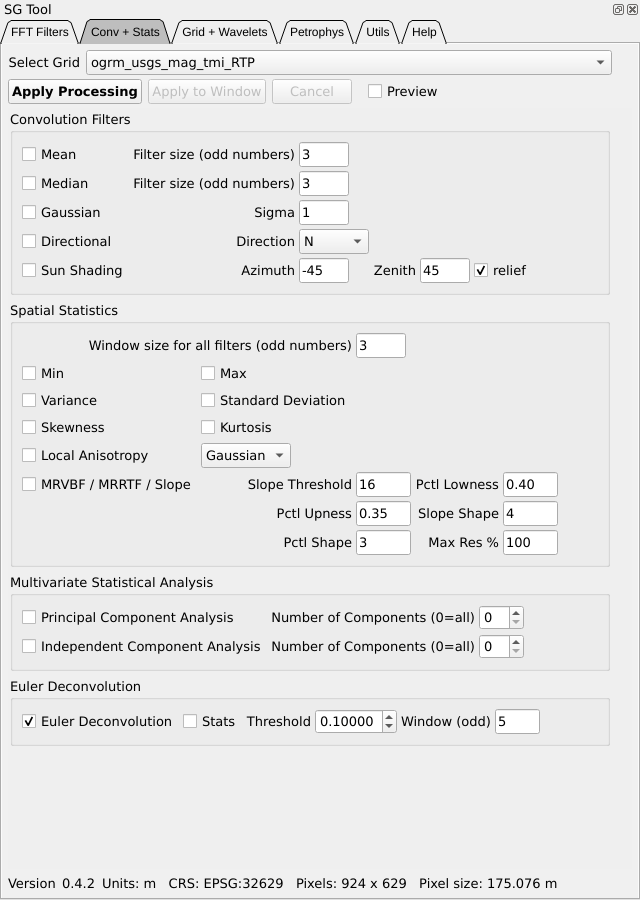

**Example: SI 1, window 5, threshold 0.1, of the RTP.** The solutions are drawn over the RTP 1VD, coloured by depth (depths between 0 and 5000 m shown).

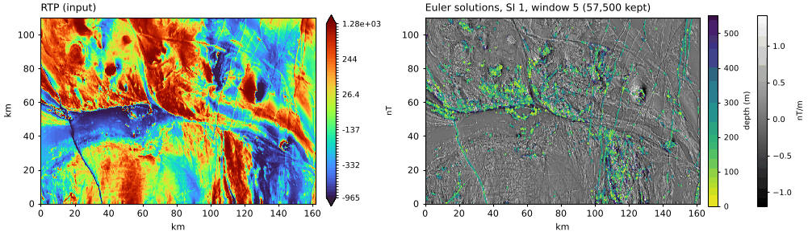

---

## Grid + Wavelets tab

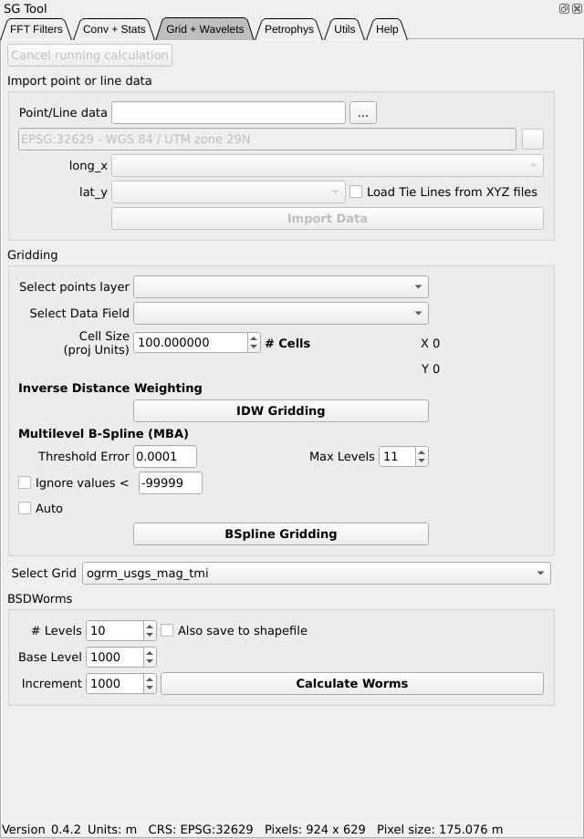

**Cancel running calculation** at the top stops gridding or worms.

### Import point or line data

| Setting | Meaning |
|---|---|
| **Point/Line data** and **...** | The file to import: CSV, ASEG-GDF2 `.dat`, or `.xyz` line data |
| CRS | The coordinate system of the data |
| **long_x**, **lat_y** | The columns holding the x (longitude) and y (latitude) coordinates |
| **Load Tie Lines from XYZ files** | Also load the tie lines of XYZ line data |
| **Import Data** | Imports the points as a layer in the project |

*In SGTool*: original code.

### Gridding

| Setting | Default | Meaning |
|---|---|---|
| **Select points layer** | | The point layer to grid |
| **Select Data Field** | | The field to grid |
| **Cell Size (proj Units)** | 100 | Output cell size, in the layer's units; **# Cells** shows the resulting grid size |
| **IDW Gridding** | | Opens QGIS's GRASS `v.surf.idw` (inverse distance weighting) dialog |
| **Threshold Error** | 0.0001 | B-spline: the calculation stops early when no point misfits by more than this |
| **Max Levels** | 11 | B-spline: the number of levels of the multilevel B-spline |
| **Ignore values <** | unticked, -99999 | Leave out points with values below this (dummy values) |
| **Auto** | unticked | Choose the cell size and Max Levels from the points (below) |
| **BSpline Gridding** | | Grids the field with multilevel B-splines |

The B-spline grid is saved as `<points>_<field>_bspline.tif`.

*Reference*: multilevel B-splines, Lee, Wolberg & Shin (1997); inverse distance weighting, Shepard (1968).
*In SGTool*: B-spline gridding is a statement-by-statement Python translation of SAGA's Multilevel B-Spline tool (O. Conrad, `grid_spline`), which agrees with SAGA to about 32-bit float precision. IDW is not SGTool's code: the QGIS dialog opens GRASS GIS `v.surf.idw` (in ArcGIS Pro, IDW and Esri's Spline are toolbox tools).

#### Choosing the B-spline settings (Auto)

Tick **Auto** (ArcGIS Pro GUI: the **Auto** box beside the cell size; toolbox and Processing algorithm: the *choose automatically* option) to have the cell size and Max Levels worked out from the points. Typing either value yourself switches Auto off.

- **Cell size**: the median distance from a random place inside the survey to the nearest data point is measured. For flight lines it is a quarter of the line spacing, the usual rule of thumb for a gridding cell, so that distance is used; for scattered points it is about half the mean point spacing, so twice it is used. The result is rounded to two significant figures (a suggestion good to 30% does not need more). It works in the units of the layer, including degrees for latitude/longitude data, where east-west distances are shortened by cos(latitude) before measuring and the dialog also shows the cell's size in metres. A cell size you choose yourself is compared with the suggestion, and the dialog says so if it is more than twice it (detail is smoothed away) or less than 0.4 times it (most cells are far from any data).
- **Max Levels**: level L of the multilevel B-spline has a control lattice of range / 2<sup>L-1</sup> (range being the longer side of the grid). Auto picks the level at which that lattice is half the output cell, `round(2 + log2(range / cell))`. Levels beyond that cannot add detail the grid can show, and on noisy data they start fitting the noise: in a held-out test on 824,000 aeromagnetic points the error was lowest at that level and slightly higher with more, while the run time kept growing with every level.
- **Threshold Error** is not chosen automatically. The calculation only stops early when no point is above it, which noisy data never allows, so Max Levels is what controls the run time.

*In SGTool* (Auto): original method and code.

### BSDWorms

| Setting | Default | Meaning |
|---|---|---|
| **Select Grid** | | The grid to worm |
| **# Levels** | 10 | Number of upward-continuation heights |
| **Base Level** | 1000 | The first height, in metres |
| **Increment** | 1000 | Step between heights, in metres |
| **Also save to shapefile** | unticked | Also save the worms as 3D polylines (PolylineZ, with the level as each vertex's Z and in the `Z` field) |
| **Calculate Worms** | | Runs the calculation |

Worms are calculated by upward continuing the data to a series of heights (levels) and finding the edges at each level with wavelet transforms of the horizontal gradient. The source depth of an edge is approximately **half the upward continuation height** of the level it appears at (Jacobsen, 1987), so edges that persist up to a level of 2000 m come from sources at about 1000 m depth. This is a guide, not a precise depth. The points are saved as a single CSV file, `<grid>_worms.csv`, for 3D visualisation (and optionally `<grid>_worms.shp`), with the padded grid, beside the input. Needs scikit-learn and networkx.

*Reference*: Hornby, Boschetti & Horowitz (1999); depth rule, Jacobsen (1987).
*In SGTool*: the worm detection is Frank Horowitz's [bsdwormer](https://bitbucket.org/fghorow/bsdwormer/) code. SGTool adds the preparation of the grid (mean removed, no-data filled, 20% linear-ramp padding and a Hanning window), the loop over levels, and the CSV and shapefile output.

---

## Petrophys tab

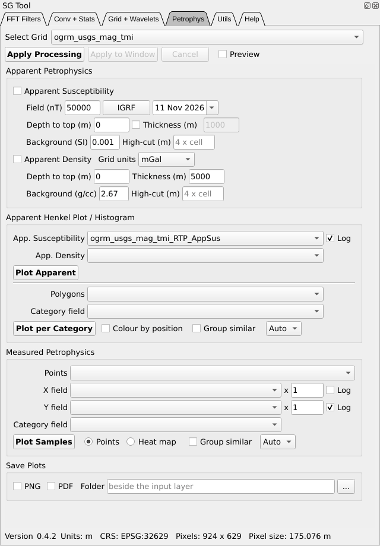

The Petrophys tab (QGIS and ArcGIS Pro) turns magnetic and gravity grids into **apparent susceptibility** and **apparent density** grids, and plots them against each other as **Henkel plots** (density against log susceptibility), for the whole area or for each unit of a geology map. Measured samples (any two properties of a point layer) can be plotted the same way, so apparent and measured properties can be compared. With only one property chosen, any of the plots becomes a histogram.

| Box | What it does |
|---|---|
| **Apparent Petrophysics** | Calculates an apparent susceptibility or apparent density grid from the grid selected at the top of the tab (Apply Processing, with live Preview) |
| **Apparent Henkel Plot / Histogram** | Plots an apparent density grid against an apparent susceptibility grid, for the whole area (Plot Apparent) or for each category of a polygon layer (Plot per Category) |
| **Measured Petrophysics** | Plots any two fields of a point layer of samples against each other (Plot Samples) |
| **Save Plots** | Also saves each plot as PNG and/or PDF |

The workflow is described step by step in the [user guide](user-guide.md#10-apparent-susceptibility-density-and-henkel-plots).

### Apparent Petrophysics

Apparent Susceptibility and Apparent Density are tick boxes, at most one ticked at a time (ticking one unticks the other; both start unticked, so arriving on the tab with Preview on calculates nothing until one is ticked). **Apply Processing** on this tab runs the ticked one only, and Apply on the other tabs never runs them. Both need a grid in a metre-based projection.

| Setting | Default | Meaning |
|---|---|---|
| **Apparent Susceptibility** | | From an RTP magnetic anomaly grid (nT); output `_AppSus`, in SI |
| **Field (nT)**, **IGRF**, date | 50000, today | *F*, the total field strength |
| **Depth to top (m)** | 0 | *z*: 0 puts the top at the sensor; for airborne data use the terrain clearance |
| **Thickness (m)** | unticked (infinite), 1000 | *t*: tick for a layer of finite thickness |
| **Background (SI)** | 0.001 | Added to the result |
| **High-cut (m)** | blank (4 x cell size) | High-cut wavelength (below) |
| **Apparent Density** | | From a Bouguer gravity grid; output `_AppDens`, in g/cc |
| **Grid units** | mGal | mGal or µm/s² |
| **Depth to top (m)** | 0 | *z* |
| **Thickness (m)** | 5000 | *t* |
| **Background (g/cc)** | 2.67 | Added to the result |
| **High-cut (m)** | blank (4 x cell size) | High-cut wavelength (below) |

Both model the ground as a layer of vertical prisms whose top is a depth *z* below the sensor and which is *t* thick, and divide the layer's response out of the grid in the Fourier domain (*k* is the radial wavenumber in rad/m).

*Reference*: the Fourier-domain response of a layer, Parker (1973); apparent density mapping, Granser, Meurers & Steinhauser (1989).
*In SGTool*: original code. The layer response is divided out directly, with SGTool's high-cut taper, without the k = 0 term, and with a background added (see below).

#### Apparent susceptibility

From a magnetic anomaly grid (nT) already reduced to the pole (or to the equator, when the result is only approximate), magnetised by induction in an ambient field of strength *F* (nT):

    T(k) = chi(k) * F/2 * exp(-k z) * (1 - exp(-k t))

With an infinite thickness (the default) the last term is dropped. The result is in SI units.

- **Input**: the anomaly after IGRF removal and RTP. Using the TMI anomaly without RTP partly cancels the positive and negative lobes of each anomaly.
- **Field (nT)**: the full IGRF total intensity (for example about 58,000 nT in Western Australia, 36,751 nT for the example grid), not anything taken from the anomaly grid. It is filled in from the IGRF at the centre of the grid on the date shown whenever a grid is selected, the date changes or **IGRF** is pressed, or from the grid's own metadata if it records the field intensity. It can also be typed in.

**Example: apparent susceptibility of the RTP** (Field 36751 nT, depth 0, infinite thickness, background 0.001).

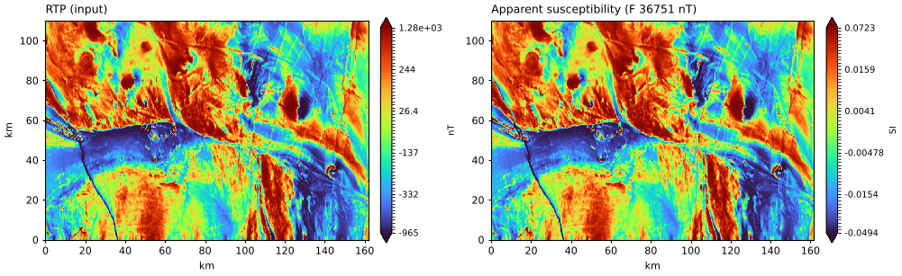

#### Apparent density

From a Bouguer gravity grid, with *G* = 6.674e-11:

    g(k) = 2 pi G drho(k) * exp(-k z) * (1 - exp(-k t)) / k

The result is in g/cc.

- **Grid units**: mGal or µm/s² (gravity units; 1 mGal = 10 µm/s²). Geoscience Australia's national grids are in µm/s². A Bouguer grid of the Yilgarn spanning hundreds of units is almost certainly in µm/s².
- **Thickness**: thin layers exaggerate the density contrasts needed to explain long-wavelength anomalies; 5000 m is the default.

#### Levels, backgrounds and the high-cut

The absolute level of either grid (its datum, the regional field, the IGRF removal) carries no density or susceptibility information, so the *k* = 0 term is not used. Each result is a zero-mean variation to which a background is added: 2.67 g/cc for density and 0.001 SI for susceptibility. Values at or below zero are still plotted on the log axis of Henkel plots (see below).

Dividing by the response amplifies short wavelengths, so both calculations apply a high-cut: wavelengths longer than twice the cutoff pass, those at the cutoff or shorter are removed, with a cosine roll-off between. Blank uses 4 x the cell size; 0 turns it off. (In the Processing algorithms, 0 means 4 x the cell size and -1 none.)

Each output records its settings in its provenance metadata (Utils tab, Read metadata).

### Henkel plots, scatter plots and histograms

Each plot is drawn as soon as its button is pressed, in its own matplotlib window (whose toolbar can also save it). With PNG and/or PDF ticked under **Save Plots** it is saved too, in the chosen folder or, if that is blank, beside the input layer.

On a log axis, if any values are zero or less, all of them are shifted so the minimum plots just above zero: the axis then shows value - minimum + d, with d 0.1% of the range (rounded to one figure), and the axis label says so, for example "Susceptibility (SI) - min (-0.00425) + 1e-05". Nothing is left out. The median, mean and SD in the corner of a histogram are of the unshifted values. Each plot's title gives the number of cells (or samples) plotted, and each panel of a per-category plot its number and percentage of that total. Heat maps count points per bin on a log colour scale (viridis), with empty bins left white.

#### Apparent Henkel Plot / Histogram

| Control | Meaning |
|---|---|
| **App. Susceptibility**, **Log** | The apparent susceptibility grid, on a log axis when ticked |
| **App. Density** | The apparent density grid |
| **Plot Apparent** | Heat map for the whole area; with one grid blank, a histogram of the other |
| **Polygons**, **Category field** | A polygon layer (e.g. geology) and its unit field |
| **Plot per Category** | One panel per category |
| **Colour by position** | Colour each bin by its position on the plot instead of by its count |
| **Group similar**, number of groups | Group categories with similar distributions (below) |

*Reference*: Henkel plots (density against log susceptibility), Henkel (1991).
*In SGTool*: original code (matplotlib).

- **Plot Apparent**: a heat map (200 x 200 bins) of the chosen apparent density grid (linear x axis) against the apparent susceptibility grid (log y axis). Each cell of the coarser grid (usually gravity) is paired with the nearest cell of the finer grid, reprojected if the CRSs differ; cells where either grid has no data are left out. The axes span the 5-95 percentiles so FFT edge effects and outliers don't squash the plot (the top and bottom 5% of cells fall outside it).
- **Plot per Category**: the same grids clipped to the polygons of each category of a polygon layer (or of its selected polygons), e.g. the lithologies of a geology map. Categories with cells where both grids have data get a heat map each, in a grid of ceil(sqrt(N)) columns. All panels share their axes and colour scale, which shows the fraction of each category's cells per bin, so small and large units compare fairly. With **Colour by position** ticked, each bin is coloured by where it is on the plot instead (red to green along the density axis, red to blue up the susceptibility axis: low density and susceptibility red, dense green, magnetic blue, both cyan), and the fraction per bin is shown by opacity, solid where most crowded and faint where sparse.

**Example: histogram of the apparent susceptibility** (App. Density left blank). Because there are negative values, the log axis is shifted (value - minimum + 0.0004), as its label says.

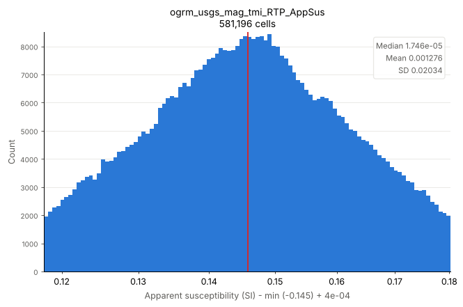

#### Measured Petrophysics

| Control | Meaning |
|---|---|
| **Points** | A point layer of samples |
| **X field**, **Y field**, multiplier, **Log** | The properties to plot, a factor to convert their units, and log axes |
| **Category field** | Colour and marker per category |
| **Plot Samples**, **Points** / **Heat map** | Draw every sample, or samples per bin |
| **Group similar** | As above |

**Plot Samples** plots the **Y field** against the **X field** of a point layer (or of its selected points). Any measured properties can be used; with density as X and susceptibility as Y (log) it is a Henkel plot.

- The axes are named after the fields, and the category legend after the category field.
- Fields can be numeric, or text holding numbers (`2.67`, ` 2,67 `); values that aren't numbers, and NULLs, are skipped.
- Each field has a **multiplier** (e.g. 0.001 for kg/m3 to g/cc, 0.00001 for x10^-5 SI to SI) and its own **Log** tick box (X linear and Y log by default).
- **Points** plots every sample. With a **category field**, each category gets a colour and marker: 8 colours x 8 markers give up to 64 categories, assigned by sample count (the 8 largest are circles in the 8 colours, the next 8 squares, and so on); any further categories are grouped as Other. The legend lists the categories by name, with their sample counts.
- **Heat map** shows samples per bin instead, for large datasets (it ignores the category).

#### One variable only: histograms

Leave either apparent grid, or either measured field, blank to plot a histogram of the other instead:

- Apparent density has linear bins and apparent susceptibility log bins; a measured field follows its Log tick box.
- With a category (polygons for the apparent grids, a category field for samples) there is one histogram per category, in a grid of panels sharing their bins and axes, each showing the fraction of its category's values per bin.
- Every histogram marks its **median** with a red line and gives the median, mean and standard deviation of its values in the top right corner. The vertical axis stops at the tallest bar of all the panels, rounded up.

#### Grouping similar categories

Tick **Group similar** (next to Plot per Category, and next to Plot Samples) to group categories whose distributions are alike and label them **A, B, C ...**:

- Each category's fraction of cells (or samples) per bin, on the plotted bins and lightly smoothed, is compared with every other category's using the Jensen-Shannon distance (0 = identical, 1 = no overlap), and the categories are grouped by average-linkage hierarchical clustering.
  *Reference*: Jensen-Shannon divergence, Lin (1991); average linkage (UPGMA), Sokal & Michener (1958). *In SGTool*: original code; the smoothing of the distributions and the choice of the number of groups are SGTool's.
- The box beside it sets the number of groups: **Auto** cuts the clustering at its largest jump (one group if all the categories are alike), or choose 2 to 8.
- Categories with **more than one peak** (for example a map unit that covers two lithologies) are grouped only among themselves and labelled **Bimodal** (or **Bimodal 1, 2 ...** if there are several such groups), with a dashed outline. A mixture of two populations lies between them, so otherwise it would join whichever group it happens to be nearest. A category counts as having several peaks if its smoothed histogram (1-D, or 2-D for Henkel plots and sample scatter plots), cut at some height between 5% and 80% of its maximum, splits into separate parts that each hold at least 10% (and 10) of its values and rise at least 25% above the cut. In tests it reliably flags two equal-width populations whose means are about 3.5 standard deviations apart when they are in equal proportions, or 4 when one is 30% of the values, and it flagged no single-peaked distributions, skewed ones included. Closer populations, which show as a single broad or shouldered peak, count as single-peaked. The number of groups chosen applies to the single-peaked categories; the multi-peaked ones are always grouped automatically.
- Groups are lettered in order of their mean position along the x axis (for Henkel plots, A is the lightest).
- Per-category panels (heat maps and histograms) are ordered by group (A, B ... then Bimodal), with the group before the name in the title ("A - Granite") and a frame in the group's colour (histogram bars too). In the sample plot the group is shown the same way in the legend, which is sorted by group.
- Categories with fewer than 30 cells (10 samples) are not grouped and have no group label.

A similar distribution does not mean the same geology, and apparent values blur across boundaries, so small polygons tend to group with their neighbours: use the groups as a prompt for interpretation, not a classification.

### Save Plots

| Control | Default | Meaning |
|---|---|---|
| **PNG**, **PDF** | unticked | Also save each plot in these formats |
| **Folder** | beside the input layer | Where to save them |

### Preparing sample data

Petrophysical databases often hold one row per measurement (sample number, property, value) rather than one row per sample. The script [`scripts/pivot_petrophysics.py`](../scripts/pivot_petrophysics.py), run in the QGIS Python console with the layer selected, makes a temporary layer with one point per sample and a `<property>_val` field for each property (repeats of a property on one sample are averaged), copying columns that are the same on every row of a sample (such as lithology) for use as the category field. The column names it reads (`SAMPLENO`, `PROPERTY`, `Value`) and the short property names are set at the top of the script.

### Other ways to run it

- **QGIS Processing**: *Apparent susceptibility* and *Apparent density* algorithms in the SGTool Petrophysics group, with the same settings (thickness 0 = infinite, high-cut 0 = 4 x the cell size and -1 = none).
- **ArcGIS Pro**: the same tab in the SGTool GUI, and **Apparent Susceptibility** and **Apparent Density** tools in the toolbox's Petrophysics category. In the GUI the polygons and sample points are chosen as files, and all their features are used. See [ArcGIS Pro](#arcgis-pro).
- **Apply the same steps to another grid** repeats both calculations; the field strength of apparent susceptibility is used as recorded, not recalculated for the new grid.

---

## Utils tab

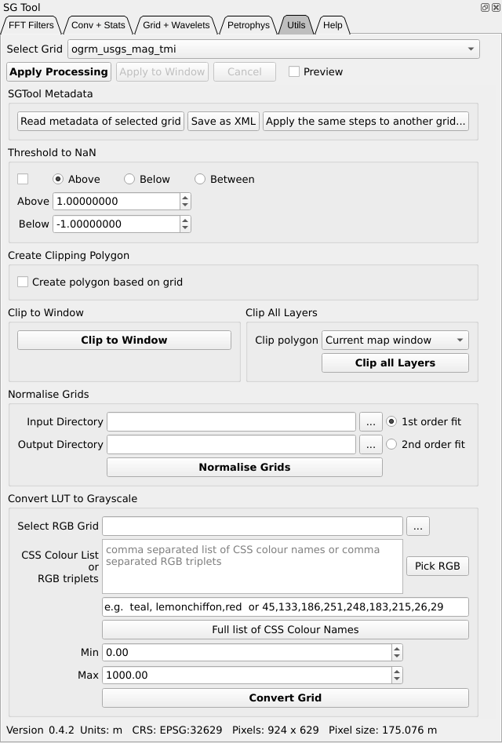

*In SGTool*: all the utilities below are original code.

### SGTool Metadata (provenance)

| Button | What it does |
|---|---|
| **Read metadata of selected grid** | Shows the history of the selected grid |
| **Save as XML** | Saves that history as `<grid file>.sgt.xml` |
| **Apply the same steps to another grid...** | Repeats the steps of the selected grid's history on another grid ([below](#apply-the-same-steps-to-another-grid)) |

Every file SGTool saves, in QGIS or ArcGIS Pro, records how it was made. For **GeoTIFFs** this is stored inside the file itself, in its own GDAL metadata domain (`SGTOOL`, item `provenance_xml`), the same way the Noddy grid import stores its header, so it travels with the file when it is copied or renamed. The operation, creation time and SGTool version are also written as ordinary GeoTIFF metadata items (`SGTOOL_OPERATION`, `SGTOOL_CREATED`, `SGTOOL_VERSION`) so they show in the QGIS layer properties. Files that cannot carry metadata (shapefiles, CSV and TXT outputs) get a small XML sidecar instead, named after the file with `.sgt.xml` added (for example `pts.csv.shp.sgt.xml`); the same sidecar is the fallback if a GeoTIFF cannot be updated (for example because it is locked). The record contains:

- **When**: the date and time of creation (with time zone) and the SGTool version.
- **Source**: the path of the file or files it was made from, plus any XML metadata those sources carry: their own SGTool record (embedded or sidecar, so each step contains the steps before it and a chain of processing can be followed back to the original data), GDAL `.aux.xml` (the band statistics, without the bulky histogram), and other `.xml` sidecars such as the `.grd.xml` that accompanies Geosoft grids.
- **How**: the operation and the parameters that were set to create it (for example azimuth, line spacing and scale for the directional filter, or structural index and window size for Euler deconvolution).

**Reading it back**: select a grid and press **Read metadata of selected grid** (in ArcGIS Pro, **Read metadata of input grid**). A new window shows the history (this step, then each earlier step nested beneath the file it produced, with the parameters used and the source statistics) and the raw XML. If the grid has no SGTool metadata, a message at the top of the map canvas says so. **Save as XML** writes the same record to a file called `<grid file>.sgt.xml` in the grid's folder (for example `grid_DirC.tif.sgt.xml`), replacing any existing file of that name, so it can be kept, shared or opened in other tools. It is a snapshot: the GeoTIFF's own embedded record is left untouched, and (in QGIS) the exported file is removed if the plugin later overwrites or deletes that grid. A history made in one version can be read, and replayed, in the other. The metadata viewer also shows the history of a GeoSubSampler vector result selected in the layer panel; steps made by GeoSubSampler are shown but cannot be replayed.

Sidecars record the output's size and modified time when written, so a sidecar left beside a file that another program has since overwritten can be recognised (`sidecar_status()` in `calcs/sgt_metadata.py` reports `current`, `stale`, `missing` or `unknown`). When the plugin overwrites or deletes a file it also removes any old-style sidecar for it. Metadata embedded in a GeoTIFF needs no such clean-up as it is part of the file, and files made by earlier SGTool versions with a `.sgt.xml` sidecar are still read.

This covers filter outputs, gridding, imports and conversions, Euler solutions and window statistics, PCA/ICA, MRVBF, worms, grid normalisation and boundary outlines. Temporary preview layers are not saved to disk so carry no record, but a result saved with **Apply Preview** does. Recording provenance can never stop a calculation: if it fails, a message is printed to the Python console and processing carries on. (Grids made through the GRASS IDW dialog are written by that dialog and do not get a sidecar yet.)

### Apply the same steps to another grid

Select a grid that was made by SGTool and press **Apply the same steps to another grid...**. The steps in its provenance are listed oldest first with their recorded settings; tick the ones to repeat (**Apply**), tick which intermediate results to keep (**Save**, all ticked by default; an unticked step's file is deleted once the next step has been made from it, and the last result is always kept; its history still lists every step), choose the grid to apply them to and press **Apply steps**. Each step runs on the result of the one before, and every result is saved next to the new grid with the usual names (`grid.tif`, `grid_RTP.tif`, `grid_RTP_d1z.tif`, ...) and its own provenance, so the new grid has a complete history of its own. In QGIS the results you keep are added to the project; in ArcGIS Pro (button **Apply same steps to another grid...**) they are added to the layer list and loaded into the map with the **Load SGTool Outputs** tool. It runs in the background and can be cancelled.

- **Magnetic reductions**: reduction to the pole, reduction to the equator and differential RTP depend on the field direction where the survey was flown, so the inclination and declination are recalculated from the IGRF model for the new grid's location (from its centre, or from its four corners for differential RTP) and a survey date you can set. The new grid needs a coordinate system with an EPSG code. Grids that carry their own inclination and declination, such as Noddy models, use those.
- Steps that cannot be repeated (gridding, Euler deconvolution, component analysis, anything made from several grids) are shown greyed with the reason, and skipped. Histories written by the dialog and by the Processing algorithms can both be replayed.
- In QGIS, the **Apply the steps of a processing history to a grid** Processing algorithm does the same for batch use: give the grid to process and a grid, or a saved `.sgt.xml` file, to take the history from.

### Threshold to NaN

| Setting | Default | Meaning |
|---|---|---|
| Tick box | unticked | Tick to apply with **Apply Processing** |
| **Above** / **Below** / **Between** | Above | Which values become no-data |
| **Above** | 1 | Upper threshold |
| **Below** | -1 | Lower threshold |

Sets values above or below a bound, or between two bounds, to no-data, so they are excluded from display and further processing. Useful when reprojected grids have an unwanted border. Output `_Clean`. Can be previewed.

**Example: above 1000** (of the TMI). The strongest anomalies become no-data (white).

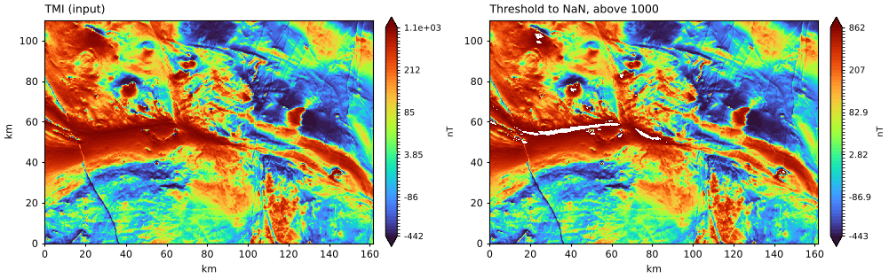

### Create Clipping Polygon

Tick **Create polygon based on grid** and press **Apply Processing** to create one or more polygons outlining the parts of the grid that have data, as a shapefile `<grid>_boundary`. Useful, amongst other things, for clipping worms or Euler solutions to the grid area. Cannot be previewed.

### Clip to Window

Clips the grid selected in the Utils tab to the area currently shown in the map window. The **Clip to Window** button sits to the left of Clip All Layers. The clip is saved beside the original as `<name>_clip.tif` and loaded into the project with the same styling as the original, and its provenance records the source grid and the cell window that was cut out. All bands of a multiband grid are kept, and the cell size and values are unchanged (the window is cut on cell boundaries, so it can be up to a cell larger than the view). An earlier clip is never overwritten: if `<name>_clip.tif` already exists, or a layer of that name is loaded, the new clip is called `<name>_clip_01`, then `<name>_clip_02` and so on. The window is reprojected to the grid's coordinate system if the map uses a different one, and a window that does not overlap the grid gives a warning.

**ArcGIS Pro**: the **Clip to Window** button on the GUI's Utils tab does the same for the input grid and the part of the ArcGIS Pro map you are looking at (it uses the map view the toolbox tool writes, so launch the GUI from the toolbox and keep the map open). The result is `<name>_clip.tif` (then `_clip_01`, ...), added to the layer list and loaded into the map with **Load SGTool Outputs**.

### Clip All Layers

| Control | Default | Meaning |
|---|---|---|
| **Clip polygon** | Current map window | The map window, or a polygon layer |
| **Clip all Layers** | | Asks for a folder and clips every layer of the project |

Leave the dropdown on **Current map window** (the default) to clip to the area the map shows, or pick a polygon layer (if some of its polygons are selected, only those are used), and press **Clip all Layers**, then choose a folder. Every layer in the project's layer tree is clipped to the polygon and saved there as `<name>_clip` (a GeoPackage for vector layers, a GeoTIFF for grids) with a `<name>_clip.qml` holding its style, and a copy of the project, `<project>_clip.qgz`, is saved beside them. It has the same groups, order, visibility and styles as the current project, loads the clipped files under the names `<name>_clip` with relative paths, and opens on the polygon. A clip polygon layer is saved too (the map window is not, as it is not a layer). The polygon is reprojected to each layer's coordinate system first. Layers that cannot be clipped (web layers such as WMS or XYZ tiles, tables without geometry) are carried over unchanged, a layer that fails is listed in the SGTool messages log and left out, and the temporary preview layer is skipped. Grids are cut on their own cell edges, so cell sizes, positions and values are unchanged, and grids with no no-data value get -9999 outside the polygon. Layers that do not overlap the clip area are left out and listed in the log. Based on a script by Mark Jessell.

**ArcGIS Pro**: the toolbox tool **Clip All Layers to Polygon (Current Project)** (Utils) does the same for a map of the open project: choose the polygon layer, an output folder and (optionally) the map. The clipped vector layers go into one file geodatabase, `<project>_clip.gdb`, as `<name>_clip` feature classes (the polygon too), the grids are `<name>_clip.tif`, each layer's symbology is saved as `<name>_clip.lyrx`, and `<project>_clip.aprx`, a copy of the project, has every clipped layer pointing at its new data and renamed `<name>_clip`, so groups, order, symbology, bookmarks and layouts are kept. Only the chosen map is changed. Web layers, annotation and tables are left as they are, a layer's definition query is applied (its selection is not), and the tool stops when you press Cancel. It must be run from inside ArcGIS Pro with the project open.

### Normalise Grids

| Setting | Meaning |
|---|---|
| **Input Directory** | Folder of GeoTIFFs to normalise |
| **Output Directory** | Folder for the results |
| **1st order fit** / **2nd order fit** | Order of the regional removed from each grid |
| **Normalise Grids** | Runs the calculation |

Normalises the means and standard deviations of a series of grids in a folder, to minimise mismatches when they are merged. It does not consider the overlaps between grids: it simply standardises the data and removes a first or second order regional.

### Convert LUT to Grayscale

| Setting | Default | Meaning |
|---|---|---|
| **Select RGB Grid** | | A registered 3-band RGB image of a grid |
| **CSS Colour List or RGB triplets** | | The colour table, from the lowest to the highest value: [matplotlib CSS colour names](https://matplotlib.org/stable/gallery/color/named_colors.html#css-colors) (`teal, lemonchiffon, red`) or RGB triplets (`45,133,186, 251,248,183, 215,26,29`) |
| **Pick RGB** | | Pick colours from the screen |
| **Full list of CSS Colour Names** | | Opens the list of names |
| **Min**, **Max** | 0, 1000 | The values the first and last colours stand for |
| **Convert Grid** | | Saves the grey-scale grid as `<name>_gray.tif` |

Converts a 3-band RGB image into a monotonically increasing grey-scale grid, if you provide the colour table (look-up table) it was drawn with.

---

## Help tab

Links to the example grid, Noddy models (the Atlas of Structural Geophysics and the Noddy installer), the code repository, the help file, and the people and projects whose code SGTool uses.

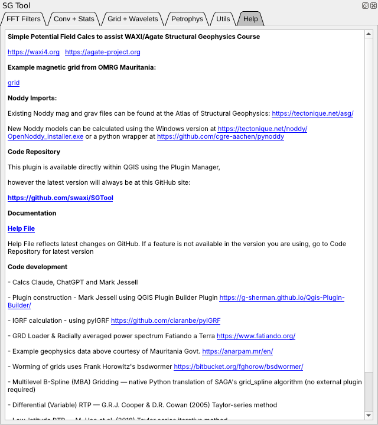

---

## QGIS Processing algorithms

(The ArcGIS Pro version has its own toolbox, `SGTool.pyt`, with the filters as geoprocessing tools; see [ArcGIS Pro](#arcgis-pro).)

The filters are also available as QGIS **Processing** algorithms in the **SGTool** group of the Processing Toolbox, so they can be used in the graphical modeler, the batch-processing dialog and Python scripts, for example `processing.run("sgtool:derivative", {"INPUT": "grid.tif", "DIRECTION": 0, "POWER": 1, "OUTPUT": "grid_d1z.tif"})`. They call the same calculation code as the plugin dialog, so for the same settings the results are identical, and each result is a GeoTIFF with its provenance embedded, chained to the provenance of the input.

**Output files**: the output is optional. Choose a file and it is used as given. Leave it empty and the result is saved **next to the input grid, named after it plus the processing step**, exactly as the dialog does (`grid.tif` gives `grid_d1z.tif`, `grid_UC.tif`, `grid_BP.tif`, `grid_DirC.tif` and so on; apart from the derivative's power and direction, the settings are in the provenance metadata, not the name), and is added to the project under the same name. Euler solutions go to `<grid>_estimates_SI_<n>.csv` and B-spline gridding to `<points>_<field>_bspline.tif`, both next to their input. In a batch run each input's result is therefore written beside that input. If a result with that name is already open in QGIS the old layer is removed first and the file replaced, as in the dialog. (In the toolbox the empty output may be labelled "Skip output": for these algorithms that means "use the automatic name".)

**Available**: remove line noise (directional Cosine/Butterworth, with the option to output the noise estimate instead of the corrected grid), reduction to the pole and to the equator, low-latitude reduction to the pole, continuation, vertical integration, remove regional, band pass, high/low pass, AGC, derivative, tilt angle, analytic signal, total horizontal gradient, apparent susceptibility and apparent density (Petrophysics group), mean, median, Gaussian and directional filters, sun shading, windowed statistics, local anisotropy (magnitude or orientation), threshold to NaN, Euler deconvolution (one structural index per run, written as a CSV including the std of df/dz), PCA, ICA, BSDWorms (a points CSV, with the padded grid and an optional 3D polyline shapefile beside the input) and multilevel B-spline gridding (with an option to choose its cell size and number of levels automatically, see [Choosing the B-spline settings](#choosing-the-b-spline-settings-auto)). FFT-based algorithms have an optional FFT buffer size (0 = automatic). Also **Apply the steps of a processing history to a grid** (see [above](#apply-the-same-steps-to-another-grid)). Differential RTP, MRVBF and the live preview are only in the dialog for now.

Algorithms can be cancelled from the Processing dialog; as in the dialog, a single FFT step cannot be interrupted part-way.

The names to use with `processing.run("sgtool:<name>", ...)`:

| Algorithm | Name | Algorithm | Name |
|---|---|---|---|
| Remove line noise | `directional_line_noise` | Mean filter | `mean_filter` |
| Reduction to the pole | `reduction_to_pole` | Median filter | `median_filter` |
| Reduction to the pole (low latitude) | `reduction_to_pole_low_latitude` | Gaussian filter | `gaussian_filter` |
| Reduction to the equator | `reduction_to_equator` | Directional filter | `directional_filter` |
| Upward / downward continuation | `continuation` | Sun shading | `sun_shading` |
| Vertical integration | `vertical_integration` | Windowed statistic | `windowed_statistic` |
| Apparent susceptibility | `apparent_susceptibility` | Local anisotropy | `local_anisotropy` |
| Apparent density | `apparent_density` | Threshold to NaN | `threshold_to_nan` |
| Remove regional trend | `remove_regional` | Derivative | `derivative` |
| Band pass filter | `band_pass` | Tilt angle | `tilt_angle` |
| High / low pass filter | `high_low_pass` | Analytic signal | `analytic_signal` |
| Automatic gain control | `automatic_gain_control` | Total horizontal gradient | `total_horizontal_gradient` |

---

## ArcGIS Pro

Installing the ArcGIS Pro version is described in [Installation](installation.md#arcgis-pro).

The two versions share the calculation code and most features: the **Wedge** setting for line-noise removal, MRVBF / MRRTF / slope, multilevel B-spline gridding, tilt angle in degrees, provenance metadata and **Apply same steps to another grid** (a history made in one version can be read and replayed in the other, with IGRF recalculated for RTP, RTE and differential RTP), a line showing the grid's units, CRS, pixel counts and pixel size, and the same output file names (`grid_RTP.tif`, `grid_DirC.tif`, `grid_d1z.tif`, `grid_UC.tif`, `grid_Mn.tif`, `grid_SS_StdDev.tif`, `grid_PCA.tif`, `grid_Clean.tif`, Euler solutions as `grid_estimates_SI_<n>.txt`). The **Output (auto)** line at the top of the ArcGIS Pro GUI shows the names that will be written. What differs:

- **Window and layers**: the ArcGIS Pro GUI is a separate window launched from the toolbox (**Launch**), not a dock. Its layer list is refreshed with **Refresh** (it does not follow the Layers panel), and results are queued and added to the map by the toolbox tool that launched it (or by **Load SGTool Outputs**).
- **Preview** (FFT Filters, Conv + Stats, Petrophys and Utils tabs, the last for Threshold to NaN) is in its own window, as ArcGIS Pro gives a Python window no hooks into its map. Tick **Preview** next to the Apply button, tick one filter, and the window shows the result with the usual grey stretch. It opens on the part of the grid the ArcGIS Pro map is showing, in a window with the same shape as the map canvas (**Match map view** goes back to it after you have moved around). Cells that are not square are drawn true. Zoom with the wheel, pan by dragging, double-click for the whole grid. The filter is recalculated for what is in view whenever you zoom, pan or change a setting: at full detail once at most 1000 cells (on the longest side) are in view, block-averaged to 1000 cells for a larger view, as in QGIS. Zoom out to preview long-wavelength filters, as a zoomed-in view shows edge effects and only the wavelengths that fit in it. **Show original** compares with the input. The preview runs the same code as Apply, and the button reads **Apply Preview**: it saves the ticked filter at full resolution. **Apply to Window**, beside it, first clips the input grid to the area the ArcGIS Pro map shows (as **Clip to Window** on the Utils tab), makes the clip the input grid and then runs Apply Preview on it. Preview follows you between the tabs, and unticking it or closing the window ends it. Differential RTP, anisotropy, MRVBF, PCA, ICA and Euler cannot be previewed.
- **Cancel** is a button in the status bar that ends the running job at once (a step part-way through an FFT finishes in the background and is discarded). The toolbox tools stop when you press **Cancel** in the Geoprocessing pane: they check for it between steps and inside the long calculations (MRVBF, B-spline gridding, worms, normalisation), and a result calculated after Cancel is discarded, not saved.
- **Utils tab**: **Clip to Window** (clips the input grid to the part of the ArcGIS Pro map you are looking at, as in QGIS; it needs the map view the toolbox tool writes, so launch the GUI from the toolbox and keep the map open), **Read metadata of input grid** (history as text, raw XML on a second tab), **Save as XML** and **Apply same steps to another grid...** (tick which steps to **Apply** and which results to **Save**, set the survey date).
- **Petrophys tab**: the same apparent susceptibility and density calculations, Henkel plots and histograms as in QGIS (see [Petrophys tab](#petrophys-tab)). The apparent grids for plotting are chosen from the map's raster layers (or a file), and the polygons and sample points are chosen as files (shapefile, GeoPackage and other formats GDAL reads), with all their features used (QGIS uses only the selected features when some are selected). Each plot opens in its own window with a toolbar to zoom and save it. The toolbox has **Apparent Susceptibility** (leave the field strength blank to use the IGRF at the raster's centre) and **Apparent Density** tools in a Petrophysics category.
- **Gridding**: multilevel B-spline (Grid + Wavelets tab) reads a point shapefile or GeoPackage, offered automatically after **Import Data**, and writes `<points>_<field>_bspline.tif`; its **Auto** box (and a matching option in the toolbox tool) chooses the cell size and Max levels from the points. IDW and Esri's Spline are in the toolbox only and need the Spatial Analyst extension.
- **Toolbox** (`SGTool.pyt`, 39 tools) stands in for the QGIS Processing algorithms: you name each output, high and low pass are separate tools, and there is no tool for replaying a history. The MRVBF tool writes the other three results beside the one you name.
- **MRVBF slope** is calculated in numpy (QGIS uses its own slope tool); the DTM curvature classifier is gone from both versions.
- **Only in QGIS**: the dockable layout, the Layers panel and dropdown syncing, the preview layer, Processing algorithms and task manager integration.

---

## References

- Baranov, V., 1957. A new method for interpretation of aeromagnetic maps: pseudo-gravimetric anomalies. *Geophysics* 22, 359–382. https://doi.org/10.1190/1.1438369
- Baranov, V., Naudy, H., 1964. Numerical calculation of the formula of reduction to the magnetic pole. *Geophysics* 29, 67–79. https://doi.org/10.1190/1.1439334
- Bhattacharyya, B.K., 1965. Two-dimensional harmonic analysis as a tool for magnetic interpretation. *Geophysics* 30, 829–857. https://doi.org/10.1190/1.1439658
- Bigün, J., Granlund, G.H., Wiklund, J., 1991. Multidimensional orientation estimation with applications to texture analysis and optical flow. *IEEE Transactions on Pattern Analysis and Machine Intelligence* 13, 775–790. https://doi.org/10.1109/34.85668
- Butterworth, S., 1930. On the theory of filter amplifiers. *Wireless Engineer* 7, 536–541.
- Cooper, G.R.J., Cowan, D.R., 2005. Differential reduction to the pole. *Computers & Geosciences* 31, 989–999. https://doi.org/10.1016/j.cageo.2005.02.005
- Cordell, L., Grauch, V.J.S., 1985. Mapping basement magnetization zones from aeromagnetic data in the San Juan basin, New Mexico. In: Hinze, W.J. (Ed.), *The Utility of Regional Gravity and Magnetic Anomaly Maps*. Society of Exploration Geophysicists, 181–197.
- Gallant, J.C., Dowling, T.I., 2003. A multiresolution index of valley bottom flatness for mapping depositional areas. *Water Resources Research* 39(12), 1347. https://doi.org/10.1029/2002WR001426
- Granser, H., Meurers, B., Steinhauser, P., 1989. Apparent density mapping and 3D gravity inversion in the eastern Alps. *Geophysical Prospecting* 37, 279–292. https://doi.org/10.1111/j.1365-2478.1989.tb02207.x
- Gunn, P.J., 1975. Linear transformations of gravity and magnetic fields. *Geophysical Prospecting* 23, 300–312. https://doi.org/10.1111/j.1365-2478.1975.tb01530.x
- Hao, M., Zhang, F., Tai, Z., Du, W., Ren, L., Li, Y., 2018. Reduction to the pole at low latitudes by using the Taylor series iterative method. *Journal of Applied Geophysics* 159, 127–134. https://doi.org/10.1016/j.jappgeo.2018.08.004
- Henderson, R.G., Zietz, I., 1949. The upward continuation of anomalies in total magnetic intensity fields. *Geophysics* 14, 517–534. https://doi.org/10.1190/1.1437560
- Henkel, H., 1991. Petrophysical properties (density and magnetization) of rocks from the northern part of the Baltic Shield. *Tectonophysics* 192, 1–19. https://doi.org/10.1016/0040-1951(91)90242-K
- Horn, B.K.P., 1981. Hill shading and the reflectance map. *Proceedings of the IEEE* 69, 14–47. https://doi.org/10.1109/PROC.1981.11918
- Hornby, P., Boschetti, F., Horowitz, F.G., 1999. Analysis of potential field data in the wavelet domain. *Geophysical Journal International* 137, 175–196. https://doi.org/10.1046/j.1365-246x.1999.00788.x
- Hotelling, H., 1933. Analysis of a complex of statistical variables into principal components. *Journal of Educational Psychology* 24, 417–441. https://doi.org/10.1037/h0071325
- Hyvärinen, A., 1999. Fast and robust fixed-point algorithms for independent component analysis. *IEEE Transactions on Neural Networks* 10, 626–634. https://doi.org/10.1109/72.761722
- Jacobsen, B.H., 1987. A case for upward continuation as a standard separation filter for potential-field maps. *Geophysics* 52, 1138–1148. https://doi.org/10.1190/1.1442378
- Kass, M., Witkin, A., 1987. Analyzing oriented patterns. *Computer Vision, Graphics, and Image Processing* 37, 362–385. https://doi.org/10.1016/0734-189X(87)90043-0
- Kis, K.I., 1990. Transfer properties of the reduction of magnetic anomalies to the pole and to the equator. *Geophysics* 55, 1141–1147. https://doi.org/10.1190/1.1442930
- Lee, S., Wolberg, G., Shin, S.Y., 1997. Scattered data interpolation with multilevel B-splines. *IEEE Transactions on Visualization and Computer Graphics* 3, 228–244. https://doi.org/10.1109/2945.620490
- Lin, J., 1991. Divergence measures based on the Shannon entropy. *IEEE Transactions on Information Theory* 37, 145–151. https://doi.org/10.1109/18.61115
- Melo, F.F., Barbosa, V.C.F., 2020. Reliable Euler deconvolution estimates throughout the vertical derivatives of the total-field anomaly. *Computers & Geosciences* 138, 104436. https://doi.org/10.1016/j.cageo.2020.104436
- Miller, H.G., Singh, V., 1994. Potential field tilt — a new concept for location of potential field sources. *Journal of Applied Geophysics* 32, 213–217. https://doi.org/10.1016/0926-9851(94)90022-1
- Minty, B.R.S., 1991. Simple micro-levelling for aeromagnetic data. *Exploration Geophysics* 22, 591–592. https://doi.org/10.1071/EG991591
- Nabighian, M.N., 1972. The analytic signal of two-dimensional magnetic bodies with polygonal cross-section: its properties and use for automated anomaly interpretation. *Geophysics* 37, 507–517. https://doi.org/10.1190/1.1440276
- Parker, R.L., 1973. The rapid calculation of potential anomalies. *Geophysical Journal of the Royal Astronomical Society* 31, 447–455. https://doi.org/10.1111/j.1365-246X.1973.tb06513.x
- Pearson, K., 1901. On lines and planes of closest fit to systems of points in space. *Philosophical Magazine* 2, 559–572. https://doi.org/10.1080/14786440109462720
- Prewitt, J.M.S., 1970. Object enhancement and extraction. In: Lipkin, B.S., Rosenfeld, A. (Eds.), *Picture Processing and Psychopictorics*. Academic Press, New York, 75–149.
- Rajagopalan, S., Milligan, P., 1994. Image enhancement of aeromagnetic data using automatic gain control. *Exploration Geophysics* 25, 173–178. https://doi.org/10.1071/EG994173
- Reid, A.B., Allsop, J.M., Granser, H., Millett, A.J., Somerton, I.W., 1990. Magnetic interpretation in three dimensions using Euler deconvolution. *Geophysics* 55, 80–91. https://doi.org/10.1190/1.1442774
- Roest, W.R., Verhoef, J., Pilkington, M., 1992. Magnetic interpretation using the 3-D analytic signal. *Geophysics* 57, 116–125. https://doi.org/10.1190/1.1443174
- Shepard, D., 1968. A two-dimensional interpolation function for irregularly-spaced data. *Proceedings of the 1968 23rd ACM National Conference*, 517–524. https://doi.org/10.1145/800186.810616
- Sokal, R.R., Michener, C.D., 1958. A statistical method for evaluating systematic relationships. *University of Kansas Science Bulletin* 38, 1409–1438.
- Spector, A., Grant, F.S., 1970. Statistical models for interpreting aeromagnetic data. *Geophysics* 35, 293–302. https://doi.org/10.1190/1.1440092
- Thompson, D.T., 1982. EULDPH: a new technique for making computer-assisted depth estimates from magnetic data. *Geophysics* 47, 31–37. https://doi.org/10.1190/1.1441278
- Tukey, J.W., 1977. *Exploratory Data Analysis*. Addison-Wesley, Reading, MA.
- Zevenbergen, L.W., Thorne, C.R., 1987. Quantitative analysis of land surface topography. *Earth Surface Processes and Landforms* 12, 47–56. https://doi.org/10.1002/esp.3290120107
