[← Back to the documentation](README.md)

# SGTool user guide

This guide takes you through SGTool step by step, one kind of processing at a time. Every step uses the same example grid, so you can follow along and compare your results with the figures. The [reference](reference.md) describes every control and setting in detail, with the equations and published methods and a before-and-after example for each filter.

The steps are written for the **QGIS** plugin. The ArcGIS Pro version has the same tabs in its own window, with a few differences listed in [ArcGIS Pro differences](reference.md#arcgis-pro).

**Contents**

1. [The example data](#1-the-example-data)
2. [Getting started](#2-getting-started)
3. [Reduce magnetic data to the pole](#3-reduce-magnetic-data-to-the-pole)
4. [Enhance edges and structure (derivatives)](#4-enhance-edges-and-structure-derivatives)
5. [Separate shallow and deep sources (wavelength filters)](#5-separate-shallow-and-deep-sources-wavelength-filters)
6. [Clean up the data](#6-clean-up-the-data)
7. [Smooth, shade and measure texture](#7-smooth-shade-and-measure-texture)
8. [Estimate source depths (Euler deconvolution and worms)](#8-estimate-source-depths-euler-deconvolution-and-worms)
9. [Grid point and line data](#9-grid-point-and-line-data)
10. [Apparent susceptibility, density and Henkel plots](#10-apparent-susceptibility-density-and-henkel-plots)
11. [Combine several grids (PCA, ICA, normalising, colour images)](#11-combine-several-grids-pca-ica-normalising-colour-images)
12. [Clip grids and projects](#12-clip-grids-and-projects)
13. [Keep track of your processing and repeat it](#13-keep-track-of-your-processing-and-repeat-it)
14. [Batch processing and scripts](#14-batch-processing-and-scripts)
15. [Troubleshooting](#15-troubleshooting)

---

## 1. The example data

The examples use an aeromagnetic total magnetic intensity (TMI) grid of part of Mauritania, courtesy of the Mauritanian Government (OMRG) and the USGS. The **Help** tab of the plugin links to it, and it can be downloaded directly from <http://tectonique.net/sgtools_data/ogrm_usgs_mag_tmi.tif>.

| Property | Value |
|---|---|
| File | `ogrm_usgs_mag_tmi.tif` (GeoTIFF, 32-bit float) |
| Size | 924 x 629 cells, about 162 x 110 km |
| Cell size | 175 m |
| Coordinate system | WGS 84 / UTM zone 29N (EPSG:32629) |
| Centre | 10.42° W, 23.82° N |
| Values | -1410 to 5005 nT |

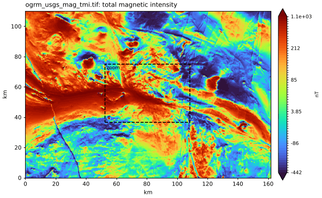

The dashed box marks the 38 x 56 km area that the zoomed examples show. Filters that act over a few cells, such as the convolution filters and window statistics, are easier to judge at that scale.

**Magnetic field at the example grid.** Pressing **IGRF** with the dialog's default survey date (1 January 2000) gives an inclination of 29.2°, a declination of -5.4° and a field strength of 36,751 nT at the centre of the grid. The examples use those values. With your own data, set the date the survey was flown.

**How the example figures were made.** Each figure shows the input on the left and the result on the right, at the same scale. Every result was calculated with SGTool's own code (`sgt_filters.py`, the same code the dialog, the Processing algorithms and the ArcGIS Pro version call) on the example grid, with the settings given in the figure title. Grids such as TMI and RTP are drawn with a histogram-equalised colour scale, and derivatives and other zero-centred results with a blue-white-red scale centred on zero.

---

## 2. Getting started

### 2.1 Install and open the plugin

1. Install **Structural Geophysics Tool** from the QGIS Plugin Manager (**Plugins > Manage and Install Plugins**). Full instructions, including ArcGIS Pro, are in [Installation](installation.md).
2. If QGIS warns that a Python package is missing, install the **qpip** plugin and let it add the package. Only some tools need extra packages: **matplotlib** for the radial power spectrum and the Petrophys plots, and **scikit-learn** for worms, PCA and ICA.
3. Click the SGTool icon on the toolbar. The SGTool panel opens docked beside the map.

### 2.2 The SGTool panel

The panel has six tabs:

| Tab | What it is for |
|---|---|
| **FFT Filters** | Reduction to the pole or equator, continuation, vertical integration, line-noise removal, regional removal, band/high/low pass, AGC, derivatives, tilt angle, analytic signal, radial power spectrum |
| **Conv + Stats** | Mean, median, Gaussian and directional filters, sun shading, window statistics, local anisotropy, MRVBF, PCA, ICA, Euler deconvolution |
| **Grid + Wavelets** | Importing point and line data, IDW and B-spline gridding, worms |
| **Petrophys** | Apparent susceptibility and density grids, Henkel plots and histograms |
| **Utils** | Provenance metadata and replay, Threshold to NaN, clipping, normalising grids, converting colour images to grey scale |
| **Help** | Links to the example data, Noddy models, the code and the help file |

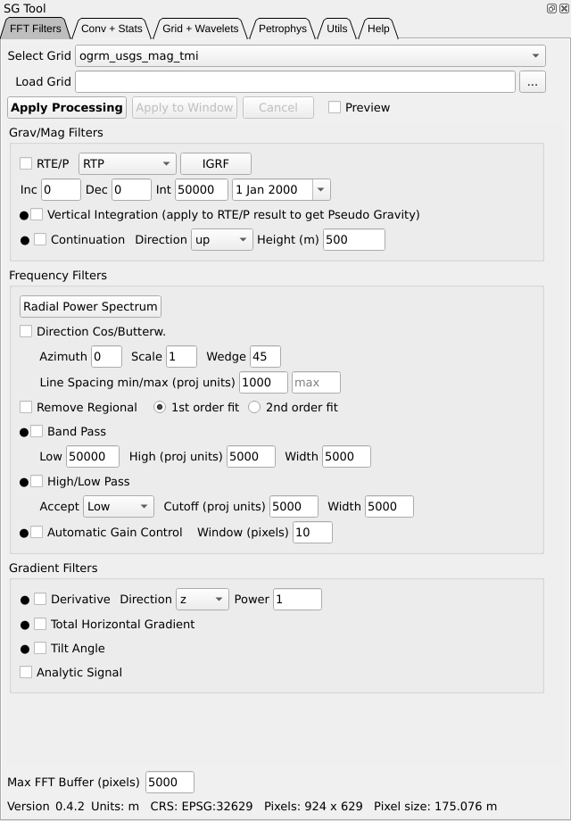

The line at the bottom of each tab shows the plugin version and, once a grid is selected, its units, coordinate system, size in cells and cell size.

### 2.3 Load the example grid

1. Download `ogrm_usgs_mag_tmi.tif` (see [The example data](#1-the-example-data)).
2. On the **FFT Filters** tab, click **...** beside **Load Grid** and choose the file. The plugin reads GeoTIFF (`.tif`), Geosoft (`.grd`), ER Mapper (`.ers`) and Noddy (`.grv`, `.mag`) grids. You can also load the grid with QGIS's own **Layer > Add Layer > Add Raster Layer**, which reads any format QGIS supports.
3. Check that **Select Grid** shows `ogrm_usgs_mag_tmi`. The line at the bottom of the tab should read *Units: m, CRS: EPSG:32629, Pixels: 924 x 629, Pixel size: 175.076 m*.

The grid shown in **Select Grid** is the one every filter on that tab is applied to.

### 2.4 How processing works

Every filter follows the same pattern:

1. Choose the grid in **Select Grid**.
2. Tick the filter and set its parameters.
3. Press **Apply Processing**.

The result is saved as a GeoTIFF **next to the input grid**, named after it with a suffix for the processing step, and added to the project. For example, `ogrm_usgs_mag_tmi.tif` reduced to the pole becomes `ogrm_usgs_mag_tmi_RTP.tif`. If that name is already used, the new grid gets `_1`, `_2` and so on. The suffixes are listed in the [reference](reference.md#output-names).

Things worth knowing:

- **One step at a time.** If you tick several filters, each one is applied to the selected grid separately, and each gives its own output. The filters are unticked once the results are saved. To chain steps (for example RTP, then the vertical derivative of the RTP), apply the first step, select its result in **Select Grid** and then apply the next step.
- **Dot points.** Filters marked with a **●** should be applied to magnetic data that have been reduced to the pole or equator (or to gravity data).
- **Lengths.** Wavelengths, heights and line spacings are in the grid's units: metres for a projected grid, degrees for a latitude/longitude grid (except continuation heights, which are always in metres). Reproject latitude/longitude grids to a metre-based system before processing where you can. Some tools (vertical integration, Euler deconvolution, the petrophysics grids) require it.
- **Background calculation.** Calculations run in the background, so QGIS stays usable. **Cancel** stops a running calculation, and nothing is saved. See [Background Calculations](reference.md#background-calculations).
- **Preview.** Tick **Preview** to see one filter on the area shown in the map, updated as you change its settings, without saving anything. The button then reads **Apply Preview**, which saves the previewed filter at full resolution. **Apply to Window** clips the grid to the map window first, then applies the filter to the clip. See [Live Preview](reference.md#live-preview).
- **Max FFT Buffer (pixels)**, at the bottom of the FFT Filters tab, limits how much padding is added around a grid before an FFT filter. The default, 5000, normally means "pad by the grid's smaller dimension".
- **History.** Every result records how it was made (see [section 13](#13-keep-track-of-your-processing-and-repeat-it)).

---

## 3. Reduce magnetic data to the pole

A magnetic anomaly is offset from its source and has positive and negative lobes, unless the field is vertical. Reduction to the pole (RTP) recalculates the data as if they had been measured at the magnetic pole, so that, for induced magnetisation, anomalies sit over their sources. Most of the other magnetic tools work best on RTP data, so this is usually the first step.

SGTool has four options in the **RTE/P** list:

| Option | Use it when |
|---|---|
| **RTP** | The magnetic inclination is steeper than about 20° (most of the world) |
| **Low-lat. RTP** | The inclination is shallower than about 20°; a stable RTP for low magnetic latitudes |
| **Diff. RTP** | The survey is large enough (several degrees) for the field direction to change across it |
| **RTE** | Reduction to the equator, an alternative at low latitudes |

### Step by step: RTP of the example grid

1. On **FFT Filters**, select `ogrm_usgs_mag_tmi` in **Select Grid**.
2. Tick **RTE/P** and choose **RTP** in the list.
3. Set the survey date in the date box, then press **IGRF**. SGTool calculates the field at the centre of the grid from the IGRF model and fills in **Inc**, **Dec** and **Int**. For the example with the default date (1 Jan 2000) these are 29.2, -5.4 and 36751.
   - You can type the values instead, if you know them from the survey report.
   - For a grid made by Noddy, the values are read from the file.
4. Press **Apply Processing**. The result is `ogrm_usgs_mag_tmi_RTP.tif`.

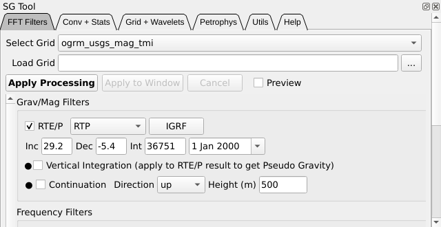

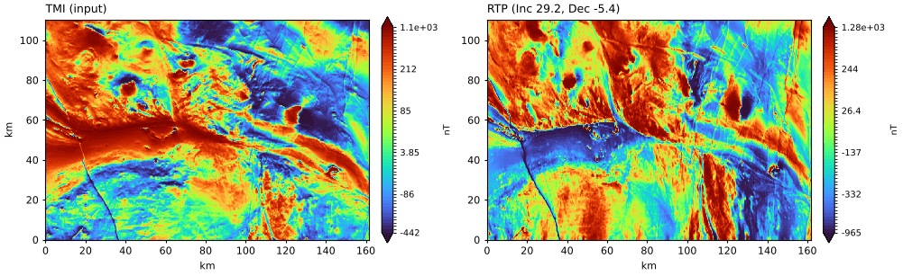

**Check the result.** In the RTP, the dipolar anomalies of the TMI (for example the circular intrusions in the north) become single positive or negative anomalies over their sources. The north-south streaks in the south of the RTP come from the low inclination: RTP amplifies anything that runs along the declination. If such streaks spoil the result, try the low-latitude RTP.

### Variations

- **Low-latitude RTP.** Choose **Low-lat. RTP** in the list. Two more settings appear. Leave **Iterations** blank to choose the number automatically. **Stripe suppression (°)** fades out the operator within that angle of the direction perpendicular to the declination: 10° (the default) helps at any low inclination, 10 to 20° suits data within a few degrees of the equator. The output is `_RTP_LL`.

  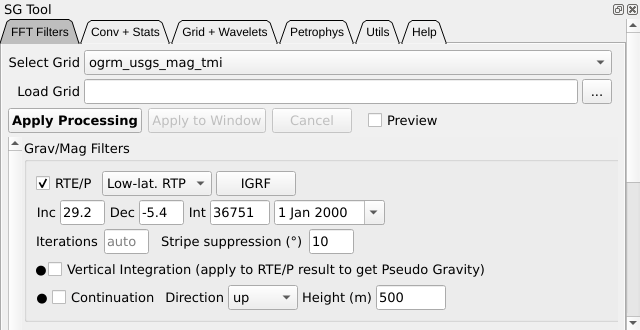

  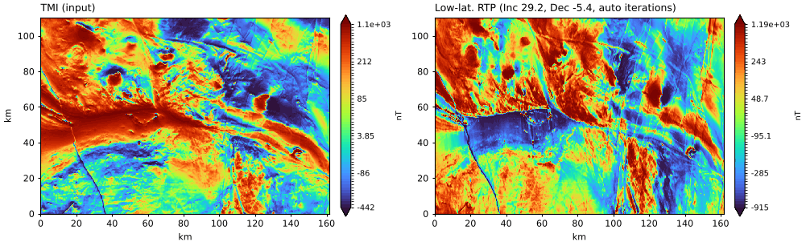

- **Differential RTP.** Choose **Diff. RTP** and press **Apply Processing**. SGTool works out the field at the four corners and centre of the grid for the date shown, so you don't enter Inc and Dec. Outputs: `_DRTP`, plus the inclination and declination it used, `_DRTP_inc` and `_DRTP_dec` (saved but not loaded). The example grid spans only about 1.6° by 1°, so the result is almost the same as the ordinary RTP.

- **Reduction to the equator.** Choose **RTE**. The output is `_RTE`. Anomalies become negative and elongated east-west over their sources, which takes some getting used to.

- **Pseudogravity.** Select the RTP grid, tick **Vertical Integration** and apply. The result (`_VI`) is proportional to the gravity anomaly that would be produced if density were proportional to magnetisation, which makes magnetic and gravity grids easier to compare.

---

## 4. Enhance edges and structure (derivatives)

Derivatives sharpen anomalies and show the edges of magnetic or dense bodies, faults, dykes and contacts. Apply them to the RTP grid.

### Step by step: vertical derivative and tilt angle

1. Select `ogrm_usgs_mag_tmi_RTP` in **Select Grid**.
2. Tick **Derivative**, set **Direction** to **z** and **Power** to **1**.
3. Tick **Tilt Angle** as well.
4. Press **Apply Processing**. Two grids are saved: `ogrm_usgs_mag_tmi_RTP_d1z.tif` (first vertical derivative, 1VD) and `ogrm_usgs_mag_tmi_RTP_TA.tif` (tilt angle).

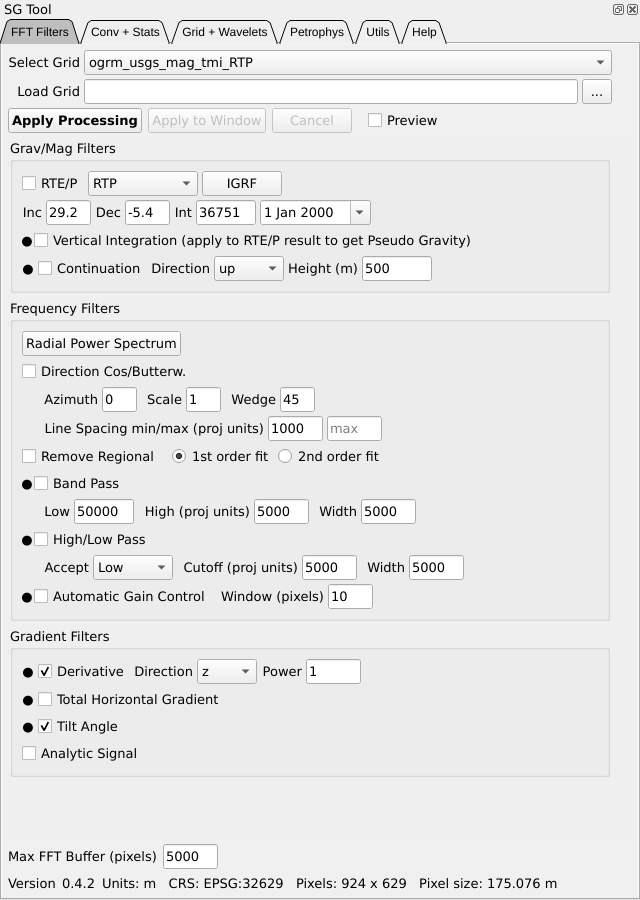

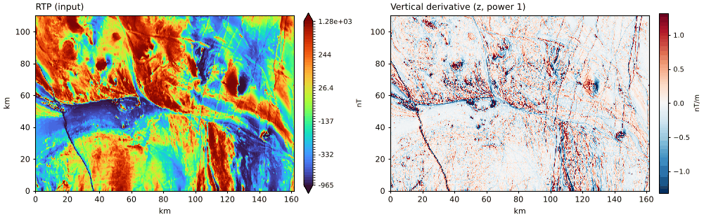

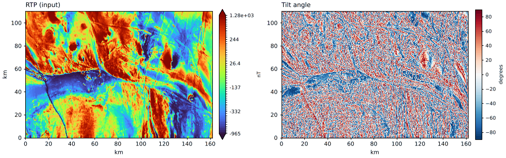

**Reading the results.**

- The **1VD** emphasises near-surface sources: dykes and faults stand out as thin lines. It also amplifies noise.
- The **tilt angle** (-90° to 90°) balances strong and weak anomalies, so faint shallow features show as clearly as strong ones. The 0° contour lies roughly over the edges of vertical-sided sources.

### Other gradient filters

| Filter | Output | What it shows |
|---|---|---|
| **Derivative**, direction x or y | `_d1x`, `_d1y` | Gradient in one horizontal direction; picks out edges perpendicular to it |
| **Derivative**, power less than 1 (e.g. 0.5) | `_d0.5z` | A gentler enhancement between the RTP and the 1VD, with less noise |
| **Total Horizontal Gradient** | `_THG` | Maxima over the edges of sources (on RTP or gravity data) |
| **Analytic Signal** | `_AS` | Maxima over the sources, almost independent of the field direction, so it can be applied to TMI at low latitudes |

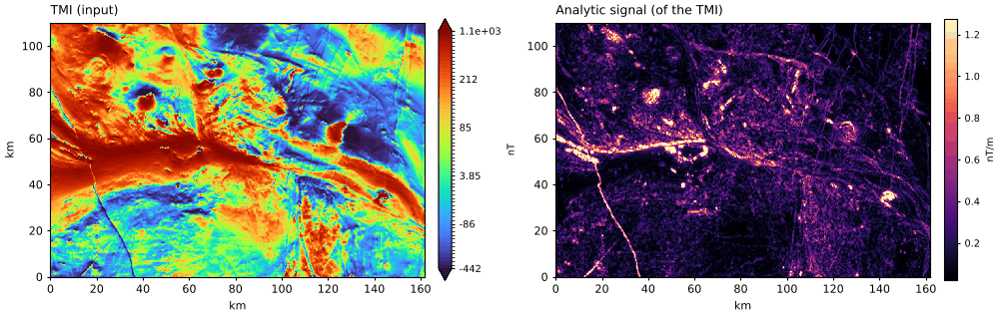

**Tip.** Tick **Preview** to try a power or direction and see the effect before saving.

---

## 5. Separate shallow and deep sources (wavelength filters)

Deep sources produce only long-wavelength (broad) anomalies, while shallow sources produce both short and long wavelengths. Filtering by wavelength therefore separates near-surface and deeper features, approximately.

### Step by step: choose the cutoffs from the power spectrum

1. Select the grid (here the TMI, or the RTP) and press **Radial Power Spectrum** on the FFT Filters tab. A window shows the grid and its radially averaged power spectrum.
2. Look for changes of slope in the curve of ln(power) against wavenumber. Each straight segment corresponds roughly to a group of sources at one depth, and the breaks between segments suggest cutoff wavelengths.

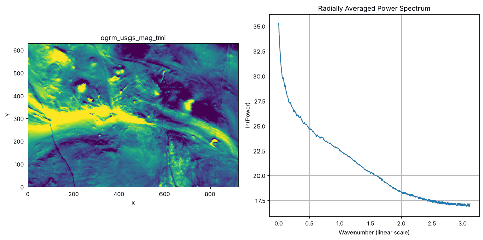

The wavenumber axis is in radians per cell, so a wavenumber *k* corresponds to a wavelength of 2π/*k* cells. For example, at the example's 175 m cells, *k* = 0.5 is a wavelength of about 2.2 km.

### Step by step: band pass

1. Select `ogrm_usgs_mag_tmi_RTP`.
2. Tick **Band Pass**. Enter **Low** = 20000, **High** = 2000 and **Width** = 1000 (all in metres). **Low** is the *longest* wavelength kept and **High** the *shortest*, so Low is the larger number.
3. Press **Apply Processing**. The result is `_BP`.

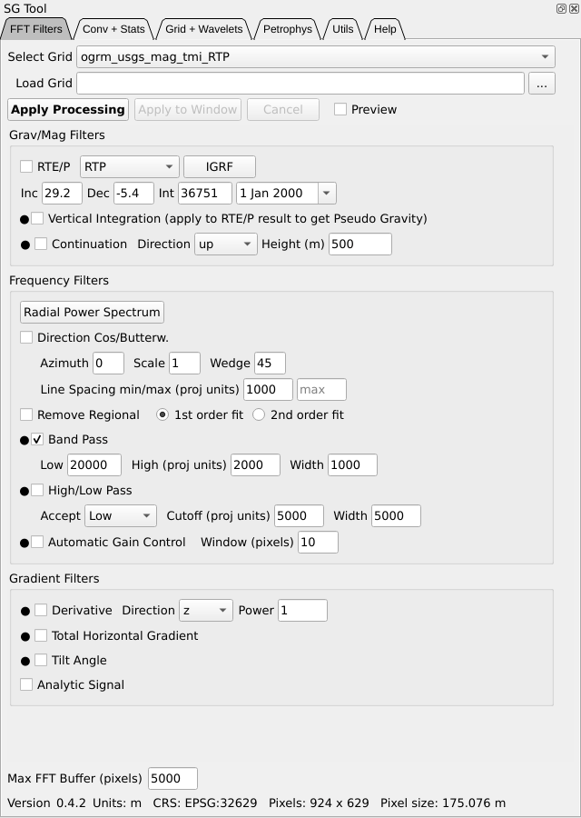

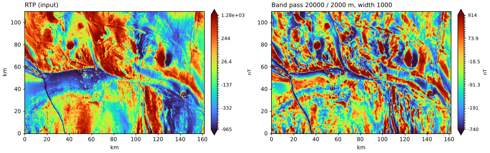

As a rough guide, a source at depth *z* has most of its signal at wavelengths of 3 to 6 times *z*. A band pass from 2000 to 20000 m therefore favours sources from roughly 300 m to 7 km deep. This is only a guide: potential-field data cannot be split exactly into depth slices. See [What the cutoff values mean](reference.md#what-the-cutoff-values-mean).

### Other ways to separate wavelengths

| Filter | Settings | Result |
|---|---|---|
| **High/Low Pass**, Accept **High** | Cutoff 10000, Width 2000 | Keeps wavelengths shorter than 10 km (residual, `_HP`) |
| **High/Low Pass**, Accept **Low** | Cutoff 10000, Width 2000 | Keeps wavelengths longer than 10 km (regional, `_LP`) |
| **Continuation**, **up** | Height 2000 m | The field 2000 m higher up: shallow sources fade, deeper ones remain (`_UC`) |
| **Continuation**, **down** | Height 100 m | The field 100 m lower down: sharper, but noise grows very quickly (`_DC`) |
| **Remove Regional** | 1st or 2nd order fit | Subtracts a fitted plane or quadratic surface (`_RR`) |

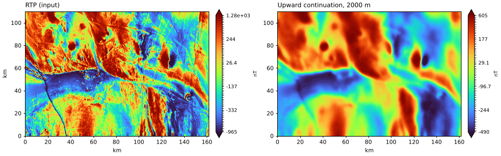

**Transition width.** A sharp cutoff (width 0) causes ringing, ripples around strong anomalies. A width of about a fifth to a half of the cutoff keeps ringing low.

**Tip.** Long-wavelength filters need to see a large area. When previewing them, zoom out so the whole grid is visible: a zoomed-in preview only contains the wavelengths that fit in the view.

---

## 6. Clean up the data

### Remove flight-line noise

Levelling errors between flight lines show as stripes parallel to the lines, especially in derivatives. The **Direction Cos/Butterw.** filter estimates that noise and subtracts it.

The example grid has little line noise, so for this example, synthetic north-south line noise (a random level error on lines 700 m apart) was added to it. The figure shows both grids as 1VD, where stripes are easiest to see.

1. Select the grid with the line noise.
2. Tick **Direction Cos/Butterw.**
3. Set **Azimuth** to the direction of the flight lines, in degrees clockwise from north (0 for north-south lines, 90 for east-west).
4. Set **Line Spacing min** to the line spacing (700 m here). If the survey has several line spacings, also set **max**.
5. Leave **Scale** at 1. A narrower **Wedge** (here 10°) takes out less of the geology that runs parallel to the lines; the default is 45°.
6. Press **Apply Processing**. The result is `_DirC`.

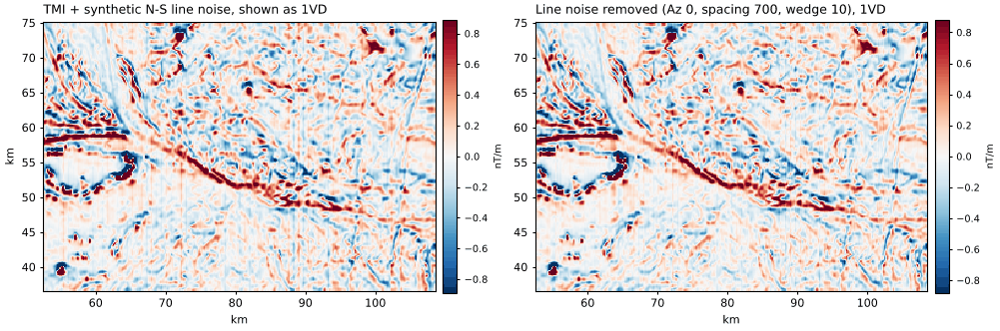

**Check what was removed.** In QGIS Processing, the *Remove line noise* algorithm can output the noise estimate itself instead of the corrected grid (**Output: Noise estimate**, giving `_DirC_noise`). It should look like stripes, not geology. If geological features parallel to the lines show up in it, narrow the wedge or reduce the scale.

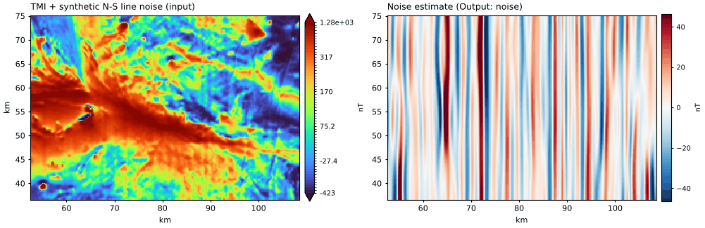

### Hide unwanted values (Threshold to NaN)

Reprojected or merged grids often have a border of zeros or a spike of bad values. **Threshold to NaN** on the **Utils** tab turns them into no-data:

1. On **Utils**, select the grid.
2. Tick the **Threshold to NaN** box and choose **Above**, **Below** or **Between**.
3. Enter the value(s) and press **Apply Processing**. The result is `_Clean`.

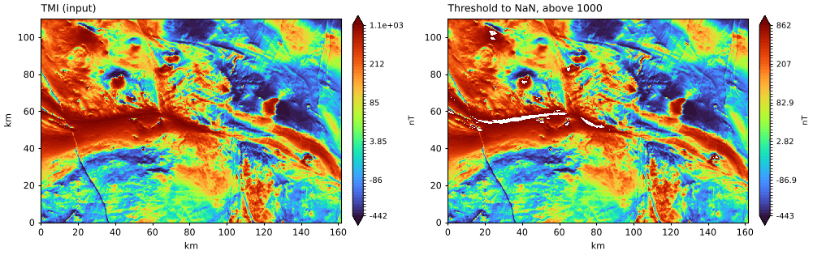

### Smooth noisy grids

A **Median** filter (Conv + Stats tab) removes spikes while keeping edges. **Mean** and **Gaussian** filters smooth everything. See [section 7](#7-smooth-shade-and-measure-texture).

---

## 7. Smooth, shade and measure texture

These filters are on the **Conv + Stats** tab, which has its own **Select Grid**.

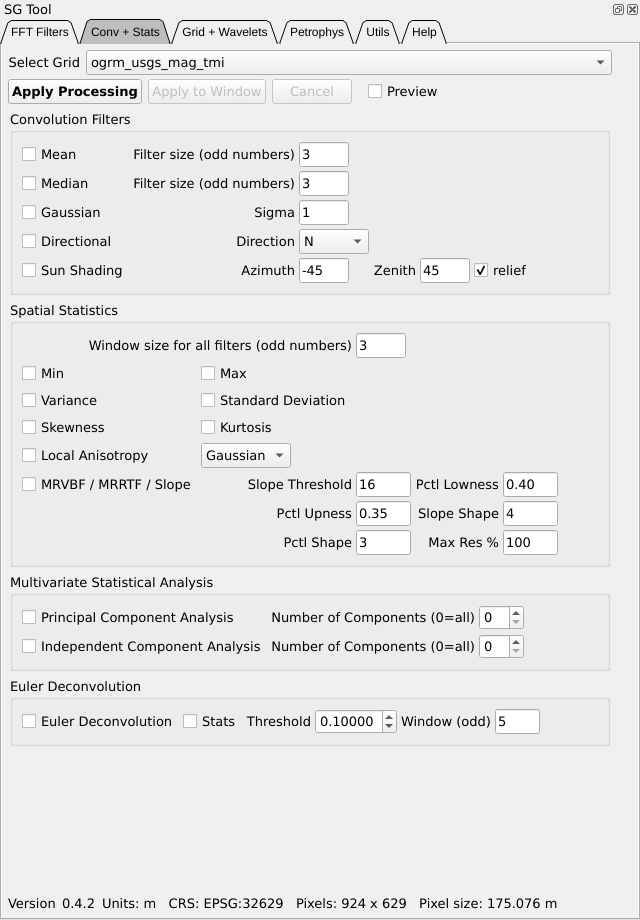

### Step by step: smoothing

1. On **Conv + Stats**, select the grid.
2. Tick **Mean**, **Median** or **Gaussian**. Set the **Filter size** (an odd number of cells) or **Sigma** (in cells).
3. Press **Apply Processing**. Results: `_Mn`, `_Md`, `_Gs`.

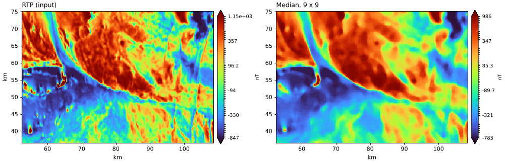

### Step by step: sun shading

Sun shading lights the grid as if it were a landscape, which shows subtle trends very clearly.

1. Select the grid (an RTP or a DEM).
2. Tick **Sun Shading**. Set the sun's **Azimuth** (the direction it shines from, degrees clockwise from north) and **Zenith** (its height above the horizon). Features perpendicular to the azimuth are enhanced most, so try several azimuths.
3. Keep **relief** ticked for the softer GRASS-style shading.
4. Press **Apply Processing**. The result is `_Sh`.

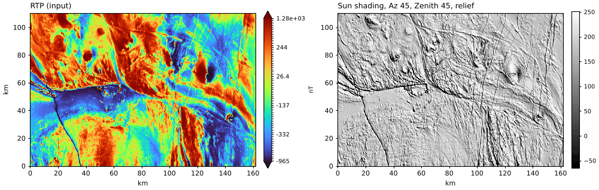

**Tip.** Display the shaded grid in grey, then put the coloured RTP above it with a *Multiply* or *Overlay* blending mode (in the layer's Symbology properties) to get a coloured, shaded image.

### Step by step: window statistics and anisotropy

Window statistics map the texture of a grid: for example, the standard deviation of the 1VD in a moving window is high where the magnetic rocks are strongly layered or faulted.

1. Select the grid (here the RTP 1VD).
2. Set **Window size for all filters** (an odd number of cells; 9 in the examples).
3. Tick one or more of **Min**, **Max**, **Variance**, **Standard Deviation**, **Skewness**, **Kurtosis**.
4. Press **Apply Processing**. Each statistic is saved separately (`_SS_StdDev` and so on).

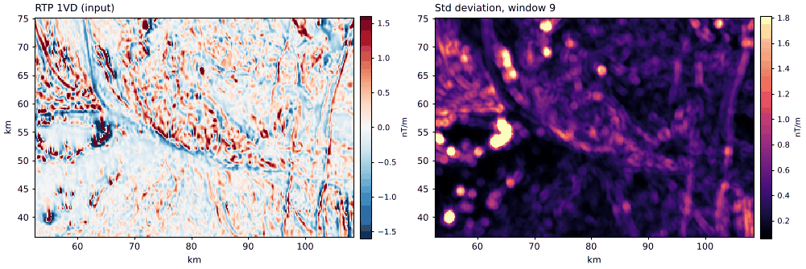

**Local Anisotropy** measures how linear the grid is around each cell. It gives two grids: `_SS_AnisoMag` (0 = no preferred direction, 1 = strongly linear) and `_SS_AnisoOrient` (the strike of the linear features, 0 to 180°).

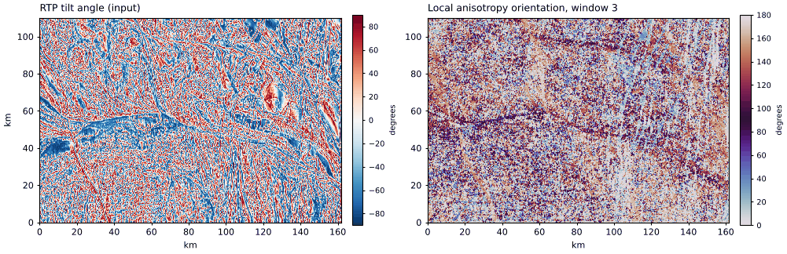

Standard deviation, variance, skewness and kurtosis are slow on large grids and large windows. Try them on a small window or a clip first.

### Automatic gain control

**Automatic Gain Control** (FFT Filters tab) divides the grid by its local amplitude, so weak anomalies in quiet areas show as clearly as strong ones. It is useful for structural mapping, but the values no longer mean anything physically.

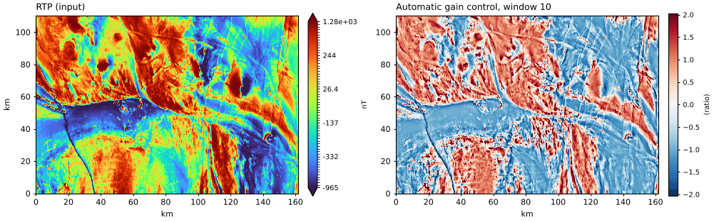

### Terrain analysis (MRVBF)

For a digital elevation model, **MRVBF / MRRTF / Slope** maps flat valley bottoms (MRVBF) and flat ridge tops (MRRTF) at several scales. It writes `_MRVBF`, `_MRRTF` and `_slope` grids and a three-band composite. The DEM must be in a metre-based projection. The default settings come from Gallant and Dowling (2003); see the [reference](reference.md#mrvbf--mrrtf--slope).

---

## 8. Estimate source depths (Euler deconvolution and worms)

### Step by step: Euler deconvolution

Euler deconvolution estimates the position and depth of sources from the gradients of the field in moving windows.

1. On **Conv + Stats**, select the RTP grid. The grid must be in a metre-based projection.
2. Tick **Euler Deconvolution**.
3. Set **Window (odd)**, the window size in cells (5 by default). Larger windows see deeper sources.
4. Set **Threshold**, the fraction of solutions kept (0.1 keeps the best 10%).
5. Tick **Stats** to also save statistics of the solutions in grid windows.
6. Press **Apply Processing**.

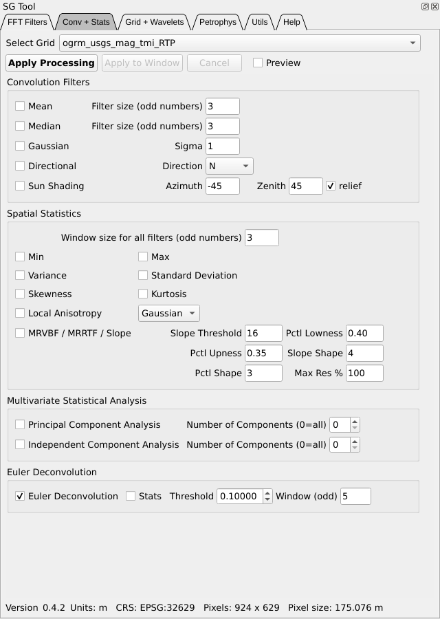

SGTool solves for four structural indices (SI): 0 (contact), 1 (dyke or sill edge), 2 (pipe) and 3 (sphere). The solutions for each are saved next to the grid as `<grid>_estimates_SI_0.txt` to `_SI_3.txt`. The columns are the northing (`y_source`), easting (`x_source`), depth (`z_source`), base level and the standard deviation of the vertical derivative in the window. Load them with **Layer > Add Layer > Add Delimited Text Layer**, with `x_source` as X and `y_source` as Y, and colour the points by `z_source`.

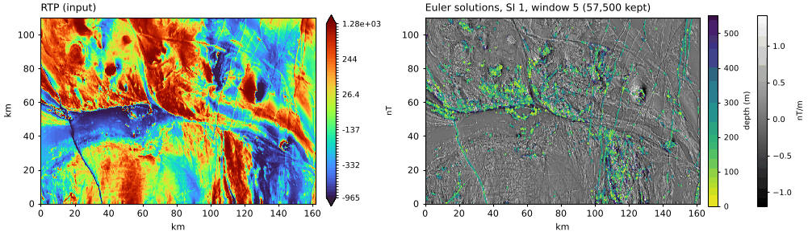

Choose the SI that suits the geology: for example, SI 1 along the dykes of the example grid. Solutions that scatter widely in depth along one feature are less reliable.

### Step by step: worms

Worms trace the edges of sources at a series of upward-continuation heights. An edge that persists to a height *h* comes from a source roughly *h*/2 deep.

1. On **Grid + Wavelets**, choose the grid in the **Select Grid** box above **BSDWorms**.
2. Set **# Levels** (the number of heights), **Base Level** (the first height, in metres) and **Increment** (the step between heights).
3. Tick **Also save to shapefile** to get 3D polylines as well as points.
4. Press **Calculate Worms**. The points are saved as a CSV next to the grid, with the height of each level, ready for 3D viewing.

Worms need the scikit-learn and networkx packages.

---

## 9. Grid point and line data

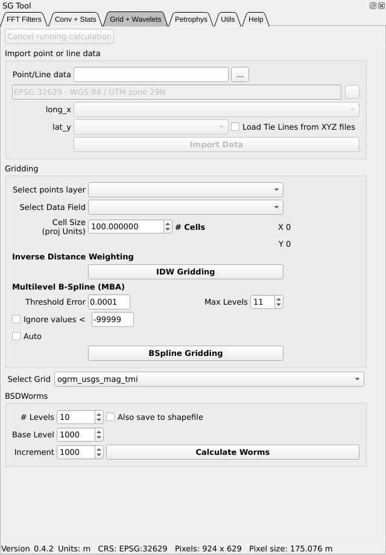

### Step by step: import points

1. On **Grid + Wavelets**, click **...** beside **Point/Line data** and choose a CSV, ASEG-GDF2 `.dat` or `.xyz` file.
2. Choose the coordinate system of the data.
3. Choose the columns holding the x (or longitude) and y (or latitude) coordinates in **long_x** and **lat_y**.
4. For XYZ line data, tick **Load Tie Lines from XYZ files** to load the tie lines too.
5. Press **Import Data**. The points are added to the project as a point layer.

### Step by step: multilevel B-spline gridding

1. In **Gridding**, choose the point layer in **Select points layer** and the value to grid in **Select Data Field**.
2. Either tick **Auto**, so SGTool chooses the **Cell Size** and **Max Levels** from the spacing of the points, or enter them yourself. For flight-line data, a cell of about a quarter of the line spacing is usual.
3. If the data use a dummy value for missing readings, tick **Ignore values <** and enter it.
4. Press **BSpline Gridding**. The grid is saved as `<points>_<field>_bspline.tif`.

How Auto chooses the settings is explained in [Choosing the B-spline settings](reference.md#choosing-the-b-spline-settings-auto).

**IDW Gridding** opens QGIS's GRASS `v.surf.idw` tool instead.

---

## 10. Apparent susceptibility, density and Henkel plots

The **Petrophys** tab estimates rock properties from the grids and compares them with measured samples. [Petrophysics](reference.md#petrophys-tab) explains the method and every setting.

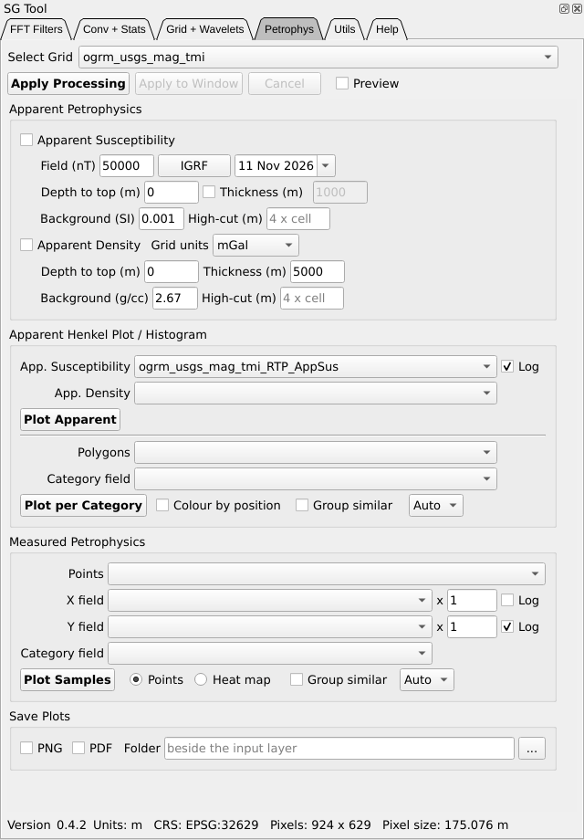

### Step by step: apparent susceptibility of the example grid

1. Make the RTP grid first ([section 3](#3-reduce-magnetic-data-to-the-pole)).
2. On **Petrophys**, select `ogrm_usgs_mag_tmi_RTP` in **Select Grid**.
3. Tick **Apparent Susceptibility**.
4. Set the date and press **IGRF** to fill in the **Field (nT)**, the total strength of the Earth's field (36751 nT for the example).
5. Set **Depth to top**: 0 puts the top of the magnetic layer at the sensor. For airborne data, use the terrain clearance.
6. Press **Apply Processing**. The result is `_AppSus`, in SI units, as a variation about the **Background** (0.001 SI).

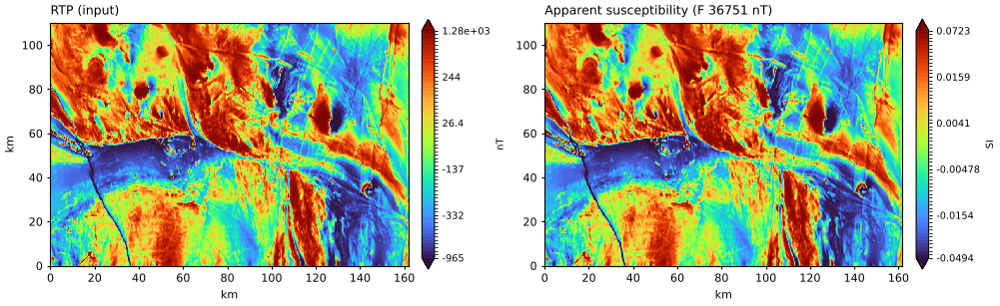

### Step by step: apparent density

1. Select a Bouguer gravity grid in **Select Grid**.
2. Tick **Apparent Density** and set **Grid units** to mGal or µm/s².
3. Set the layer **Thickness** (5000 m by default) and press **Apply Processing**. The result is `_AppDens`, in g/cc.

### Step by step: Henkel plots and histograms

1. In **Apparent Henkel Plot / Histogram**, choose the apparent susceptibility grid and the apparent density grid, and press **Plot Apparent**. The plot is a heat map of density against log susceptibility.
2. To compare geological units, choose a geology polygon layer in **Polygons** and its unit field in **Category field**, and press **Plot per Category**.
3. Leave one of the two grids blank to plot a histogram of the other.
4. Tick **PNG** and/or **PDF** under **Save Plots** to also save each plot.

The example has no gravity grid, so this is the histogram of its apparent susceptibility:

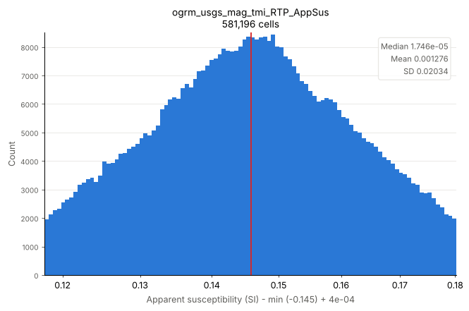

The apparent susceptibility includes negative values, so the log axis is shifted to start just above the minimum, and its label says so.

### Measured samples

In **Measured Petrophysics**, choose a point layer of samples and the fields to plot as **X** and **Y**, with a multiplier for unit conversion and a **Log** tick box for each, and press **Plot Samples**. With density as X and susceptibility as Y (log), the plot is a Henkel plot of the samples, which can be compared with the apparent one.

---

## 11. Combine several grids (PCA, ICA, normalising, colour images)

- **Principal Component Analysis** and **Independent Component Analysis** (Conv + Stats tab) work on a **multiband** grid, for example the three channels of a radiometric survey stacked into one file. Select it, tick PCA and/or ICA, set the number of components (0 = all) and press **Apply Processing**. The results are `_PCA` and `_ICA`, one band per component. Both need scikit-learn.
- **Normalise Grids** (Utils tab) adjusts a folder of grids to have the same mean and standard deviation, after removing a 1st or 2nd order trend, so that they merge with fewer steps between them. Choose the **Input Directory** and **Output Directory** and press **Normalise Grids**.
- **Convert LUT to Grayscale** (Utils tab) turns a coloured image of a grid (for example a scanned map) back into a single-band grid, if you know its colour table. Choose the RGB grid, enter the colours from lowest to highest (CSS colour names or RGB triplets), set the **Min** and **Max** of the values and press **Convert Grid**.

---

## 12. Clip grids and projects

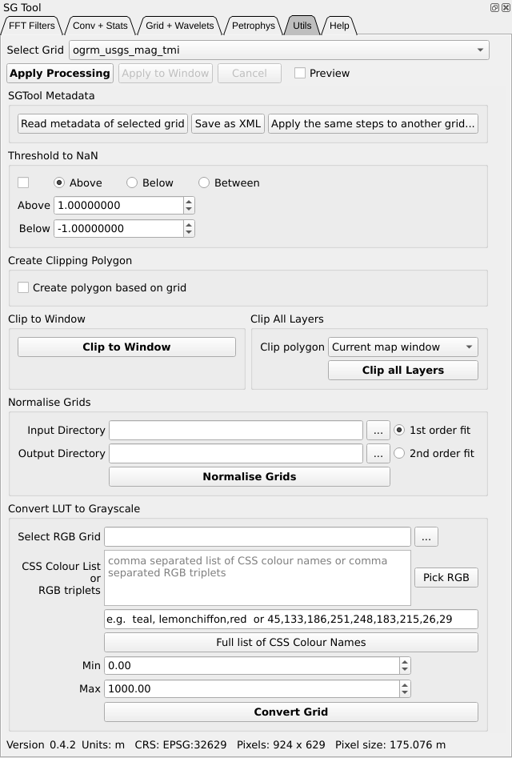

- **Clip to Window** (Utils tab) clips the selected grid to the area shown in the map, and saves it as `<name>_clip.tif`. It is the quickest way to try slow filters on a small area.
- **Create polygon based on grid** (Utils tab) outlines the area of the grid that has data, for example to clip worms or Euler solutions to the grid.
- **Clip all Layers** clips every layer of the project to the map window, or to a polygon layer chosen in **Clip polygon**, and saves them with a copy of the project, `<project>_clip.qgz`, in a folder you choose.

---

## 13. Keep track of your processing and repeat it

Every grid SGTool saves records how it was made: the date, SGTool version, the source grid (and that grid's own history) and the settings.

### Step by step: read a grid's history

1. On **Utils**, select a grid made by SGTool, for example `ogrm_usgs_mag_tmi_RTP_d1z`.
2. Press **Read metadata of selected grid**. A window shows each step, newest first, with its settings.
3. Press **Save as XML** to save the history as `<grid file>.sgt.xml`.

### Step by step: apply the same steps to another grid

1. Select a grid whose history you want to repeat, for example `ogrm_usgs_mag_tmi_RTP_d1z`.
2. Press **Apply the same steps to another grid...**.
3. Tick the steps to repeat (**Apply**) and which intermediate results to keep (**Save**).
4. Choose the grid to apply them to, set the survey date (RTP, RTE and differential RTP recalculate the field for the new grid's location), and press **Apply steps**.

See [Provenance metadata and replaying a processing history](reference.md#sgtool-metadata-provenance).

---

## 14. Batch processing and scripts

All the filters are also QGIS **Processing** algorithms, in the **SGTool** group of the Processing Toolbox. They can be run on many grids at once from the batch-processing dialog, chained in the graphical modeler, or called from Python:

```python
processing.run("sgtool:reduction_to_pole",
               {"INPUT": "ogrm_usgs_mag_tmi.tif", "INCLINATION": 29.2, "DECLINATION": -5.4})
processing.run("sgtool:derivative",
               {"INPUT": "ogrm_usgs_mag_tmi_RTP.tif", "DIRECTION": 0, "POWER": 1})
```

Left empty, the output is named and placed as the dialog would. See [Processing Algorithms](reference.md#qgis-processing-algorithms).

In **ArcGIS Pro** the same filters are geoprocessing tools in the `SGTool.pyt` toolbox. See [ArcGIS Pro differences](reference.md#arcgis-pro).

---

## 15. Troubleshooting

| Problem | What to do |
|---|---|
| "The following Python packages are required but not installed" | Install the **qpip** plugin and let it install them (see [Installation](installation.md)). |
| "You need to specify lengths in degrees" or "needs a projected coordinate system" | The grid is in latitude/longitude. Reproject it to a metre-based system (**Raster > Projections > Warp**) and process the copy. |
| RTP has strong stripes along the declination | The inclination is low. Use **Low-lat. RTP** or **RTE**. |
| RTP looks wrong everywhere | Check Inc and Dec: press **IGRF** with the right survey date, and check the grid's CRS. |
| Downward continuation is full of noise | It amplifies short wavelengths very fast. Use a smaller height, or low-pass the grid first. |
| Edge effects (ringing or bands along the grid edges) | Normal for FFT filters near edges. Process a larger area and clip the result afterwards. |
| A filter is slow | Try it on a clip first (**Clip to Window**), or use **Preview**. Skewness and kurtosis are slow on large windows. |
| The file can't be overwritten | Close it in any other program. On Windows, QGIS plugins sometimes fail to write to drives other than C:. |
| Nothing happens when pressing Apply | Check that a filter is ticked on the tab you are on, and that **Select Grid** shows a grid. Error messages appear in the QGIS message bar, with details in the Python console. |
